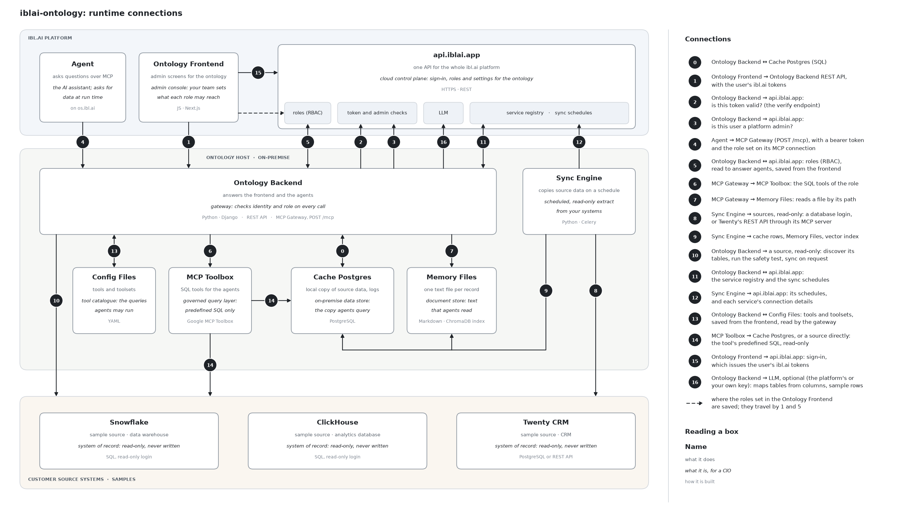

  

<h1 align="center">iblai/ontology</h1>

<strong>On-premise knowledge layer that makes an organization's existing systems queryable by AI agents over MCP — no data extraction.</strong>

  
  
  
  
  

  

---

## What it is

iblai/ontology is a **knowledge layer that runs inside your network**. It makes the systems you already run queryable by AI agents over the **Model Context Protocol (MCP)**: databases (Oracle and PeopleSoft, PostgreSQL, MySQL, SQL Server), warehouses and analytics engines (Snowflake, Trino, ClickHouse), and SaaS applications through a small connector each (Canvas, Slate, Twenty CRM, and others you add).

The prevailing approach extracts your data through a VPN tunnel into a vendor cloud. iblai/ontology does the opposite: the copy that agents query, the permissions and the logs stay on a server you own. The agent runtime, where the models run, is a separate concern and can be anywhere; it reaches the knowledge layer over MCP, one authorized request at a time.

> **You will have your data, and we may not even have access to it.**

It is **domain-agnostic**: the same stack serves a university, an enterprise, a school district, a government agency, a law firm, a financial firm or a hospital (see [What it connects to](#what-it-connects-to)).

## At a glance

| | |
|---|---|
| **Where it runs** | On one server or virtual machine in your network, as a Docker Compose stack |
| **What it reads** | Your databases and SaaS systems, with read-only access |
| **What it can change** | Nothing, until a named operation is granted to a role: one your team defined, on a login it created for that, or one a connector ships (for Twenty CRM: create and update, with the key you gave it). Each call is recorded |
| **What it keeps** | A copy for agents to query, one text file per record and a search index, all on that server |
| **Who can ask** | The AI agents and other MCP clients you authorize, each call under a named role |
| **What leaves your network** | The answer to each authorized request. Three choices send more; each is yours to make ([Where your data lives](#where-your-data-lives)) |
| **Built with** | Google MCP Toolbox for Databases, NVIDIA auto-ontology, PostgreSQL, ChromaDB, Caddy, Django |
| **Licence** | MIT, open source |

## How it works

The picture at the top shows every runtime connection. The numbers in parentheses are its numbers.

1. **A system is connected read-only.** Your team gives the Ontology Backend a read-only login for a database, or an API key for a SaaS system. A database is first put to a test: seven kinds of write are attempted, and all seven must be refused before any of its data is copied (10).
2. **Its structure is discovered and reviewed.** The backend reads the tables, columns and keys, then drafts what to copy, how often, and which questions agents may ask. Nothing is served until your team approves it.
3. **The Sync Engine copies on a schedule.** It reads the approved tables or API objects (8) and writes three things on your server (9): rows in Cache Postgres, one Markdown file per record in Memory Files, and a search index over those files. The copy is as fresh as the schedule you set.
4. **Agents ask through one gateway.** An agent calls the MCP Gateway over HTTPS (4). The gateway checks who is calling and in which role, then answers from Memory Files (7), from the cache (0), or by running one of that role's predefined queries through the MCP Toolbox (6, 14).
5. **A change happens only through a named operation.** Out of the box agents only read. To let an agent release a hold or add a note, your team writes that one operation, runs it on a login or API key created for that purpose, and grants it by name to the roles that need it. A connector can bring its operations with it: connecting Twenty CRM adds creating and updating people, companies, opportunities, notes and tasks, and no deleting. Those are granted by name too: connecting Twenty CRM makes one role that holds them, and no agent has that role until you connect one as it. An agent fills in an operation's inputs and nothing else.
6. **Each tool call is recorded**: who called, in which role, which tool, allowed or refused, when and from where. A change is recorded before it runs, with its inputs.

## Where your data lives

| What | Where it is kept | Does it leave your network? |
|---|---|---|
| Records in your source systems | Your systems. They are read; they are changed only by an operation your team defined, if it defines one | No |
| The copy agents query: cache rows, text memories, search index | The Ontology Host | Only as the answer to an authorized request |
| Logins and API keys for your systems | The Ontology Host: encrypted in the service registry, with the key in a file on that host; the MCP Toolbox and each connector read theirs from their own environment there. The key of a web API connected in the console is in the registry only: the MCP Gateway adds it to each call | Not in readable form |
| Business terms read from an NVIDIA Auto Ontology server, if you connect one | With the service registry: the Ontology Host, or your ibl.ai platform if you manage settings there. That server's access token is kept encrypted | Only if you choose that. Nothing about your systems is sent to the Auto Ontology server |
| Audit log and sync history | The Ontology Host | No |
| Roles, sync schedules and the service registry | The Ontology Host, or your ibl.ai platform if you choose to manage them there | Only if you choose that |
| Answers to agents | Sent to the agent that asked, over HTTPS | Yes: this is what the product is for |

The search index is built on your host. Text is turned into vectors by a small open model that runs locally (ChromaDB's built-in one, downloaded once), not by an outside service.

Three choices send more than answers. Each is yours:

- **Keeping settings in your ibl.ai platform.** The platform then holds the roles, the sync schedules and the service registry: the list of connected systems with the names of their tables and columns, their test and health results, and the business terms read from an Auto Ontology server if you connect one. It never holds source records. A system's login is stored there only encrypted, and the key stays on your host. The audit log and the sync history stay on your host either way. A server set up with the one-command install works this way where your platform can hold these settings. Where it cannot yet, the install says so: the roles are kept in the platform and the rest stays on the server.
- **An LLM to help map a schema.** It is off until you configure a provider: your own Anthropic or OpenAI account, or your ibl.ai platform. Schema analysis sends table and column names. The table-mapping step also sends up to five sample rows per table. Left off, discovery uses built-in rules (16).
- **Business terms written by your platform's model.** Only when an administrator asks for them, for one system at a time. The model is sent the names and types of that system's tables and columns, never a row.
- **The admin console hosted by ibl.ai.** If your administrators use it instead of a console on your host, what they view passes through that service on the way to their browser (1). It reaches your server at the address an administrator gives it once. Your platform keeps that address, or, where the platform cannot yet, that administrator's own browser does.

Administrators sign in with their ibl.ai account. The Ontology Backend asks the platform whether the token is valid and whether the person is an administrator of the platform it is configured for (2, 3).

## Security and governance

| Control | How it is enforced |
|---|---|
| **Read-only by proof** | Before a database is accepted, seven writes are attempted (create, insert, update, delete, drop, alter, truncate) and all must be refused. An unclear answer counts as a failure. The console cannot approve a database that has not passed; skipping the test takes a deliberate command-line override |
| **Identity on every call** | A call carries one of three things: a Microsoft Entra ID token, checked against your directory for signature, audience, issuer and expiry; the service token held by your ibl.ai platform; or an ibl.ai credential (a person's sign-in token, or a platform API key, such as the one the console makes for an agent). For the last, your ibl.ai platform is asked what the credential is granted, and asked again every minute. Anything else is refused |
| **Roles and least privilege** | A role lists the tool groups, the single tools, the folders of Memory Files and the cache tables it may reach, and how many rows one cache query may return; nothing else is visible to it. With an Entra ID token a caller can act only in a role the token carries; everyone else gets the default role. With the service token, the role is the one you set on the agent's connection. An ibl.ai credential carries its role and cannot name another: a person gets every role your platform administrators listed them on, a key made for an agent gets exactly the role chosen for it, and an administrator of the platform reads everything but changes nothing unless a role that lists them grants it |
| **Self-service limits** | A self-service role, such as a student's, reads only its own record. The gateway compares the person asked about with the caller's own identity and refuses anything else |
| **Predefined queries** | Agents cannot send arbitrary SQL to your systems. They call named queries your team approved, run by Google MCP Toolbox. Free SQL is possible only against the local cache, only for roles granted it, in a read-only transaction, and only on tables the role may read |
| **Changes by named operation only** | No agent can change anything until an operation exists and is granted. Your team writes one in advance: one statement or one API request, on a separate login created for writing. Or a connector ships them: for Twenty CRM, create and update and never delete, with the one API key you connected it with, so what that key may do in Twenty is the outer limit. Connecting Twenty CRM grants them to one role made for it, which reaches nothing else; no agent holds that role until you give it one. Such operations live in a tool group marked as changing data. "All tool groups" never includes one: a role holds it only when it is granted by name. A scheduled sync cannot run one and the console's test button refuses it. The gateway treats anything it cannot tell to be a read as a change |
| **Audit trail** | Each tool call by an authenticated caller is recorded: who, in which role, which tool, allowed or refused, whether it failed, when and from which address. A change is recorded before it runs, with its inputs; if it cannot be recorded, it does not run. Changes applied in the admin console are recorded too. The log stays on your host |
| **Secrets** | Logins in the service registry are encrypted at rest. The MCP Toolbox and each connector get theirs from their own environment, so no component reads another's. The key of a web API connected in the console never leaves the registry in readable form except inside the call it signs: the MCP Gateway adds it there, no agent is shown it, and it is sent only to the address it was connected with. A password or an API token is never written into the tool configuration: a literal one is refused on save. The console masks secret values when it shows configuration |
| **Network** | One port is published: HTTPS (443) on the reverse proxy. A server set up with the one-command install also opens port 80, which only obtains the certificate and sends visitors on to HTTPS. The cache, the queue and the search index sit on an internal network. The MCP Toolbox and the connectors publish no port: the MCP Gateway and the Sync Engine reach them, nothing outside does; your operators attach a connector to a source's network explicitly |
| **Transport and abuse** | A token or an API key sent to the gateway over plain HTTP is refused. Requests are rate-limited per caller, with a tighter limit on tool calls, each call in a batch counted. An Entra ID token replayed from another address is rejected |

The settings behind these are in [docs/deployment.md](docs/deployment.md#gateway-hardening-environment-variables); how access is decided is in [docs/authorization-model.md](docs/authorization-model.md).

## Built with Google MCP Toolbox and NVIDIA auto-ontology

Two open-source projects do work that iblai/ontology does not do itself.

| | [Google MCP Toolbox for Databases](https://github.com/googleapis/mcp-toolbox) | [NVIDIA auto-ontology](https://github.com/NVIDIA/auto-ontology) |
|---|---|---|
| **What it is** | Google's open-source MCP server for databases | NVIDIA's open-source framework for building semantic layers over data |
| **What it does here** | Runs the predefined queries that agents call, and the calls to a web API that an administrator named | Connects to Snowflake, Trino and ClickHouse. Where you run its server, supplies the business terms shown on the map |
| **What uses it** | The MCP Gateway | The Ontology Backend (safety test, discovery, reading a server's terms) and the Sync Engine |
| **What it is not used for** | Discovering a schema, or copying the tables discovery finds | Building a semantic layer inside iblai/ontology: only its database connectors and catalog reader are part of it |
| **Version and licence** | 1.5, Apache-2.0 | 1.2, Apache-2.0 |

**How Google MCP Toolbox applies.** It is the governed query layer between agents and SQL. Each query an agent may run is written down in advance with its parameters, by your team or drafted by discovery for your team to review, and queries are grouped into toolsets that roles are granted. When an agent calls one, the MCP Gateway first decides whether that caller's role may. Only then does it pass the call to the Toolbox, which fills in the parameters, runs the statement on the cache or on the source, and returns the rows. A change is the same thing with a different statement: an update or an API request your team wrote in advance, never text an agent composes. A web API connected in the console works the same way: each call an agent may make is named in advance, the agent fills in its inputs, and the Toolbox makes the call. The Toolbox is not reachable from outside the host: agents talk to the gateway, never to it. One exception is deliberate: free SQL against the local cache is run by the gateway itself, read-only, under the limits listed above.

**How NVIDIA auto-ontology applies.** Support for Snowflake, Trino and ClickHouse is built on auto-ontology's database connectors; iblai/ontology has no driver of its own for those three. Through them the same steps run as for any other database: the read-only test, the discovery of tables, columns and keys, and the scheduled copy. iblai/ontology does not build auto-ontology's semantic layer itself: here a schema is interpreted by iblai/ontology's rules and, if you turn it on, an LLM. An administrator can also have your platform's model write a business term for each table of a database, from the names of its tables and columns alone; joins between tables are not inferred that way. Two things follow for these three engines. Their row counts are not reported, so they show as zero. And an engine is offered only when the MCP Toolbox can serve it too, which is why Databricks and DuckDB, which auto-ontology can also read, are not.

**If you already run an Auto Ontology server.** It has worked out business terms for your databases, such as Student or Invoice line: what each means, which tables hold it, and how tables join where the database does not say. Connect that server and the map shows those terms on the tables you connected here, with the joins it inferred, and shows which terms each role's agents can reach. iblai/ontology only reads them, and for that it needs no more than the access of an ordinary viewer of that server. It sends that server nothing about your systems, changes nothing in it and runs no model for it. Terms appear for the databases both products can read: PostgreSQL, MySQL, Snowflake, Trino and ClickHouse.

The rest of the stack:

| Component | What it does here |
|---|---|
| PostgreSQL 16 | Cache Postgres: the copy agents query |
| ChromaDB 0.6 | The search index over Memory Files |
| Caddy 2 | The HTTPS reverse proxy, the only published port |
| Django 5 and Celery | The Ontology Backend and the Sync Engine |
| Redis 7 | The Sync Engine's queue; nothing is kept in it |
| MCP Python SDK | The connectors for API systems |
| Next.js 16 | The Ontology Frontend, the admin console |
| Microsoft Entra ID | Your own directory: it issues the tokens the gateway checks |

## What it connects to

- **Databases, directly:** Oracle (including PeopleSoft), PostgreSQL, MySQL, SQL Server, Snowflake, Trino and ClickHouse.
- **API systems, through a small connector each.** Connectors ship for Canvas, Slate, EAB Navigate and LDAP.
- **Twenty CRM, from the admin console.** It connects with its address and an API key, on Twenty's cloud or your own server. Its data starts arriving at once, and agents can then also create and update its records. Connecting it also makes the role an agent is given for that. Several can be connected, each under its own name, and their records are kept apart.
- **Any other system with a web API, from the admin console.** An administrator gives its address and its key, then names the calls agents may make to it, one by one. Nothing is copied from it: an agent calls it when it asks, through Google MCP Toolbox, and can make no call that was not named. A call that changes data is granted by name and recorded like any other change.
- **Everything else in the catalog is a starting point.** The built-in catalog holds a definition for the common systems of seven sectors: how to connect, which read-only operations exist, a suggested schedule. For a system without a shipped connector, that definition is what its connector is written from.

| Sector | Examples | Definitions from |
|---|---|---|
| Higher education | PeopleSoft, Ellucian Banner, Canvas LMS, Slate CRM, Workday | [iblai/higher-education-agents](https://github.com/iblai/higher-education-agents) |
| Enterprise | Snowflake, Salesforce, HubSpot, Twenty CRM, Jira | [iblai/enterprise-agents](https://github.com/iblai/enterprise-agents) |
| K-12 | PowerSchool SIS, Google Classroom, Khan Academy | [iblai/k-12-agents](https://github.com/iblai/k-12-agents) |
| Government | SAM.gov, USAspending.gov, Federal Register | [iblai/government-agents](https://github.com/iblai/government-agents) |
| Legal | Clio, Westlaw Edge, PACER | [iblai/legal-agents](https://github.com/iblai/legal-agents) |
| Financial services | Bloomberg Terminal, FactSet, Workiva | [iblai/financial-services-agents](https://github.com/iblai/financial-services-agents) |
| Healthcare | Epic (FHIR), Oracle Cerner (FHIR), PubMed | [iblai/medical-healthcare-agents](https://github.com/iblai/medical-healthcare-agents) |

## What a deployment takes

There are two ways to set it up.

**With your ibl.ai platform and the hosted console: one command on a fresh server.** The console shows the command and makes the key the install asks for. You provide:

- A fresh Ubuntu server. The install adds Docker if it is missing and leaves one folder with two files; everything else it brings lives inside Docker.
- A host name that points to the server. The proxy obtains and renews its certificate.
- Ports 80 and 443 open to the internet. The hosted console and your platform call from addresses that change, so they cannot be admitted by address; every call is guarded by sign-in instead.
- An API key for each application you connect, and a read-only login for each database.

Its roles are kept in your ibl.ai platform, and so are its other settings where the platform can hold them; otherwise they stay on the server. It runs the MCP Gateway, the Sync Engine and its queue, Cache Postgres, the search index, the MCP Toolbox and the HTTPS proxy. The MCP Toolbox there makes the calls to the web APIs an administrator connects. It runs no connectors, and predefined queries against a source database are not available on it: agents query the synced copy, use a connected application's own operations and call the endpoints named for a connected web API.

**In your network, behind your firewall: the full stack.** You provide:

- A Linux server or virtual machine in your network with Docker. The deployment guide starts at 16 GB of memory and 500 GB of disk.
- Network access from that server to the systems you want to connect.
- A read-only login for each database and an API key for each SaaS system.
- Only if agents are to change records in a system through an operation your team writes: a second login or API key for it, limited to those changes.
- An app registration in your Microsoft Entra ID, and the roles you assign to your users there.
- A DNS name for the server and a TLS certificate for it; the proxy can obtain one automatically or use yours.
- A firewall rule that admits only the networks you authorize to port 443, such as your agent runtime.

**What runs.** The MCP Gateway, the Sync Engine and its queue, Cache Postgres, the search index, the MCP Toolbox, one connector per API system and the HTTPS proxy. The agent runtime is not part of either stack.

**How it is rolled out.** Start with one system and one agent, then add sources and roles. The [deployment guide](docs/deployment.md#phased-rollout) lays out four phases: foundation, more sources, the full set, and advanced options.

**What it does not do.** It changes nothing in your systems on its own: there is no free-form write, and an agent can make only the changes that were defined and granted. It does not run the agents. It is not real-time: an agent sees the copy as of the last sync, except where a predefined query reads a source directly. A record an agent changes through a connector's operation is refreshed in the copy right away.

## Running it day to day

The Ontology Frontend is the admin console. Your team uses it to:

- **Connect a system**: pick it, give its address and login, and for a database see its structure, run the read-only test and approve it. An application such as Twenty CRM is connected in one step.
- **Watch the sync**: schedules, the last run of each, its history. A schedule you add starts by itself within a minute.
- **Decide access**: what each role may read and what it may change, per system, per tool and, for a system with a web API, per kind of request, each changed by flipping a switch. Every role is shown with how far it reaches, such as "Student (Read-Only)" or "Academic Advisor (Read-Write)".
- **Connect an agent**: pick one of your platform's agents and a role; a role that can change data is offered first. The console makes a key that carries that role and nothing more, and gives it to the agent. Removing the connection ends its access at once.
- **See the whole map**: everything the ontology knows, and who may reach it.
- **Try a tool**: call one with parameters and read the answer, before an agent does.

It runs on your host or is the one hosted by ibl.ai. On the hosted one, an administrator of a platform that has no backend yet is shown how to install one and connects it there. Your operators can also work from a command line.

## For your technical team

| Document | Covers |
|---|---|
| [DEV.md](DEV.md) | Setup, checks, running the backend locally |
| [docs/architecture.md](docs/architecture.md) | The full design: components, decisions, rollout |
| [docs/install.md](docs/install.md) | The one-command install, step by step: what the script asks and prints, what it sets up, how it is configured |
| [docs/deployment.md](docs/deployment.md) | Installing on a server, the Compose stack, networks, environment, gateway hardening, rollout |
| [docs/identity.md](docs/identity.md) · [docs/authorization-model.md](docs/authorization-model.md) | Entra ID, roles, how access is decided |
| [docs/platform-integration.md](docs/platform-integration.md) | Connecting agents on the ibl.ai platform |
| [docs/components/](docs/components/) | Each of the seven components in depth; [07](docs/components/07-cli.md) is the command line, with an end-to-end walk-through |
| [docs/read-only-db-user.md](docs/read-only-db-user.md) | Creating the read-only database login |

## License

MIT — see [LICENSE](./LICENSE).
