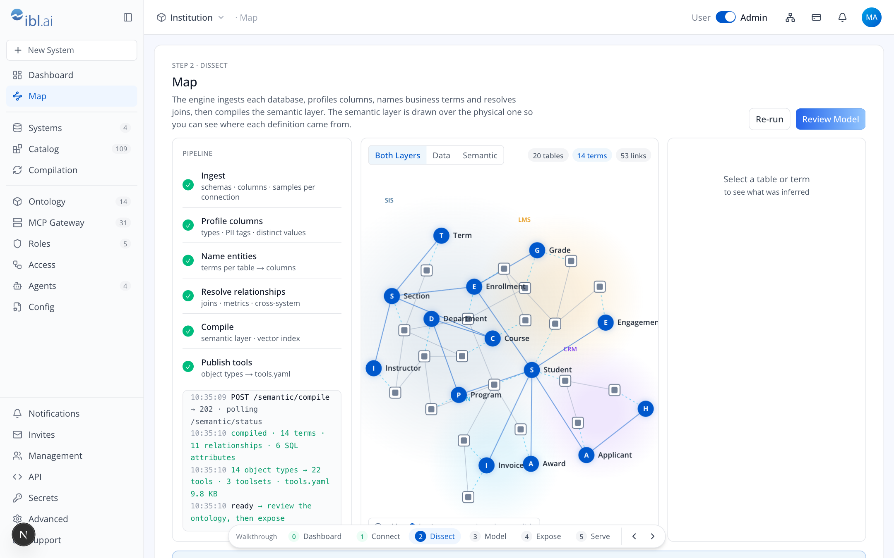
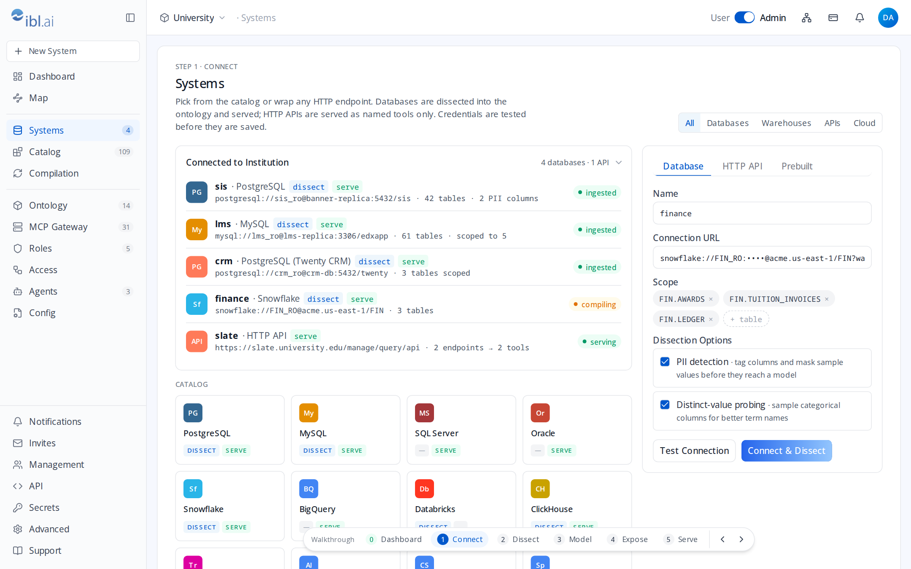
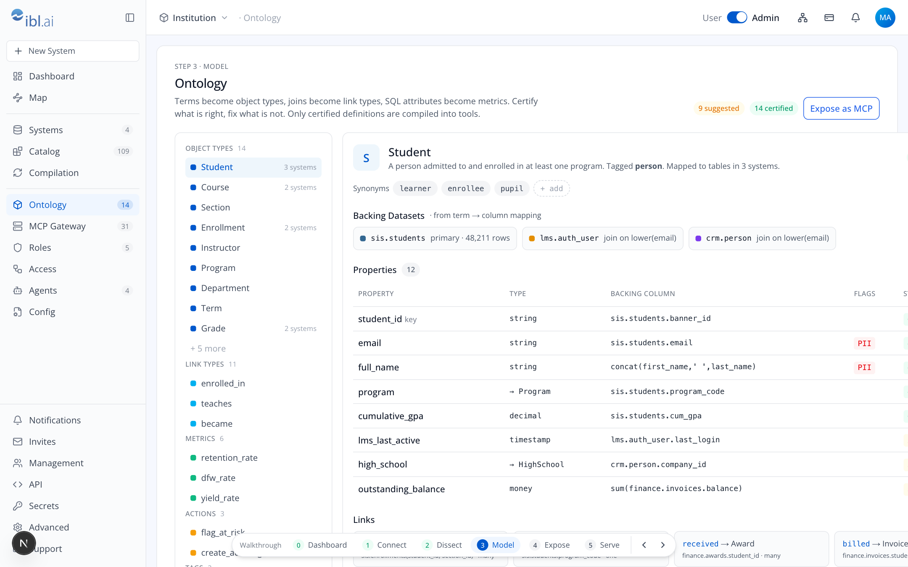
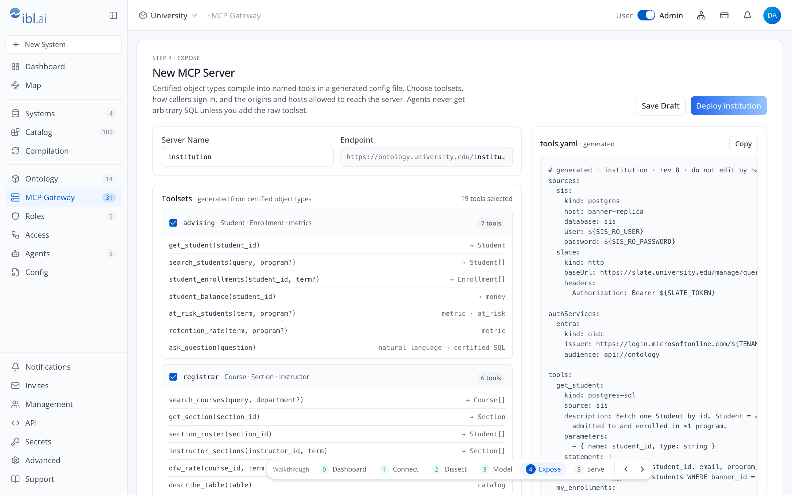
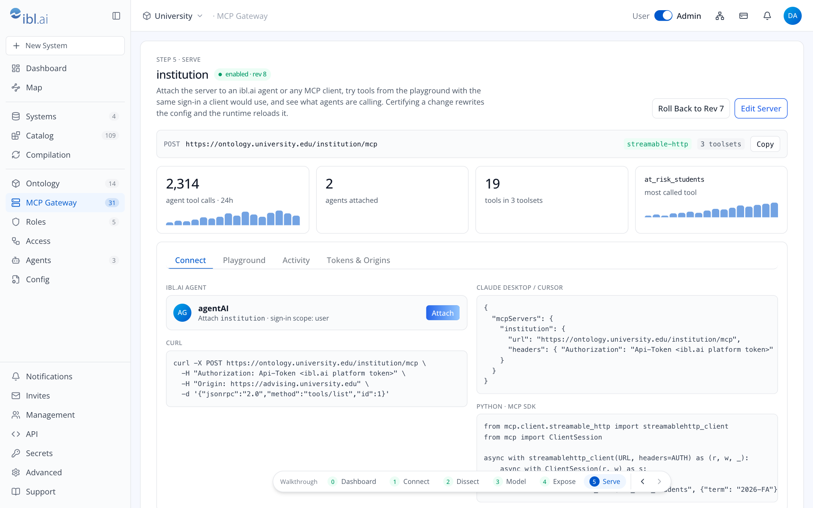
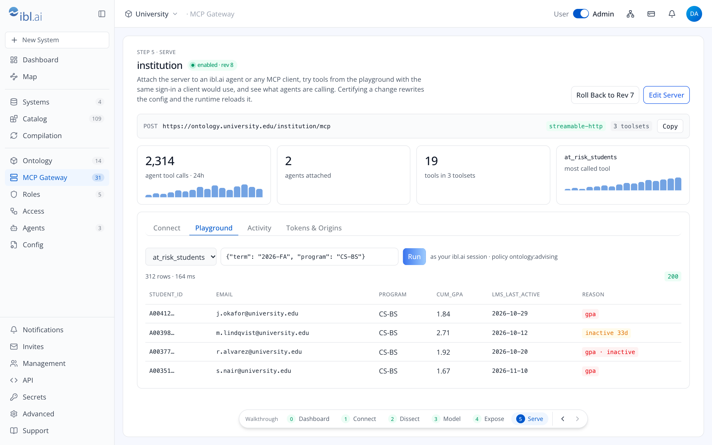
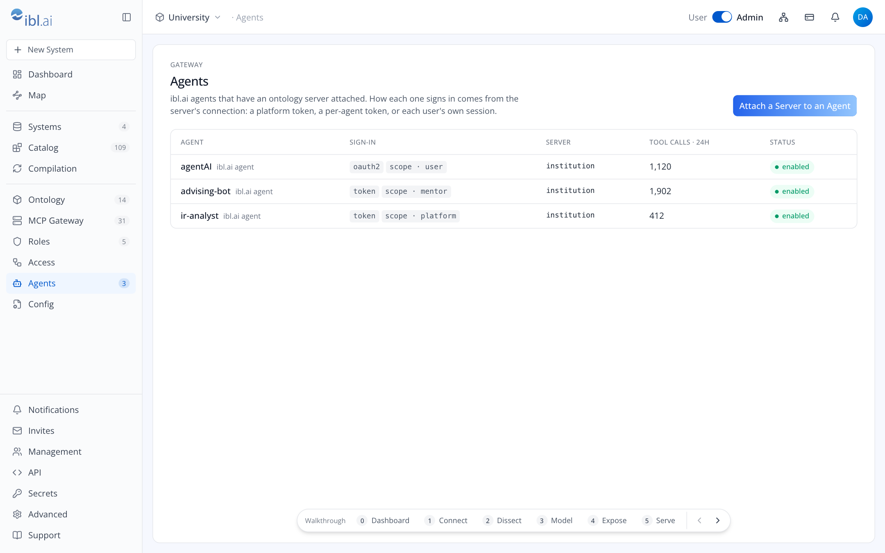

<div align="center">

<a href="https://ibl.ai"></a>

# ibl.ai/ontology

**The open-source ontology layer for AI agents.**

Connect the systems you already run, dissect them into business terms and relationships, certify the result, and publish it as MCP servers — for ibl.ai agents, Claude, Codex, and any other MCP client. One ontology. Every system. Your server, your data, any agent.

[](https://ibl.ai/join)
[](https://ibl.ai)
[](https://ibl.ai/docs)
[](LICENSE)
[](https://ibl.ai)
[](https://nextjs.org)
[](https://modelcontextprotocol.io)

<br>

### ⬇️ Get ibl.ai/ontology

<a href="docs/install.md"></a>
&nbsp;
<a href="#quick-start"></a>

<sub>Ubuntu 22.04, 24.04 or 26.04 on x86-64 · four blocks to paste · built on your server from this source → [looking after the server](docs/operations.md)</sub>

<br>

[](https://www.youtube.com/watch?v=pAFl0trxwcM)

**▶︎ [Watch the demo](https://www.youtube.com/watch?v=pAFl0trxwcM)** &nbsp;·&nbsp; _Install it on your own server and connect a database to an agent_

<br>

[Why ibl.ai/ontology](#why-iblaiontology) · [Every system](#every-system-one-ontology) · [Features](#features) · [How it works](#how-it-works) · [Case studies](#case-studies) · [Screenshots](#screenshots) · [Quick Start](#quick-start) · [Deployment](#deployment) · [Architecture](#architecture)

</div>

---

<div align="center">

**SOC 2 Type II** &nbsp;·&nbsp; Universities, enterprises, and governments run on ibl.ai — [read the case studies →](https://ibl.ai/case-studies)

</div>

---

## Why ibl.ai/ontology

|                                    |                                                                                                                                                                                                                                 |
| ---------------------------------- | ------------------------------------------------------------------------------------------------------------------------------------------------------------------------------------------------------------------------------- |
| 🔓 **Your code, your data**        | MIT-licensed and built from this source on your own server. The ontology, the database passwords and the MCP servers stay in your network, and ibl.ai/ontology keeps no database of its own.                                    |
| 🧭 **One ontology, every system**  | SQL connections and HTTP API connections become one set of business terms and relationships: a Student is the same Student in the SIS, the LMS and the CRM.                                                                     |
| ✅ **People certify, agents call** | The engine suggests terms, joins and metrics, and a person certifies them. A certified term becomes a tool with a fixed definition and fixed SQL, so an agent picks the right one and cannot widen it.                          |
| 🤖 **Any agent, over MCP**         | ibl.ai agents, Claude, Codex, Cursor or your own code call the same endpoint, and each caller sees only the toolsets its grant reaches.                                                                                         |
| 🏢 **Enterprise-ready**            | Read-only SQL connections, ibl.ai SSO and RBAC, Microsoft Entra ID, Google and custom OIDC, allowed origins and hosts, API keys limited to toolsets, rate limits, and a log of every call and every refusal.                    |
| 🧩 **Built on proven engines**     | [NVIDIA auto-ontology](https://github.com/NVIDIA/auto-ontology) infers the terms, [Google MCP Toolbox](https://github.com/googleapis/mcp-toolbox) serves the tools, and the ibl.ai platform provides sign-in, roles and agents. |

---

## Every system, one ontology

Most agent integrations are wired one system at a time. ibl.ai/ontology reads the systems you already run into one set of terms, and serves them to every agent.

<div align="center">

| System                 |     | Status                                                                                   |
| ---------------------- | --- | ---------------------------------------------------------------------------------------- |
| **PostgreSQL**         | 🐘  | Dissected into terms and served as tools                                                 |
| **MySQL**              | 🐬  | Dissected into terms and served as tools                                                 |
| **Snowflake**          | ❄️  | Dissected into terms and served as tools                                                 |
| **ClickHouse**         | ⚡  | Dissected into terms and served as tools                                                 |
| **Trino · Databricks** | 🧱  | Dissected into terms and shown on the map; not served as tools                           |
| **HTTP APIs**          | 🌐  | Served as named tools, from an OpenAPI document or the endpoints you name; not dissected |

</div>

On the other side, anything that speaks MCP can call it: ibl.ai agents, attached in one dialog; Claude Desktop and Claude Code; Codex CLI; Cursor and Windsurf; your own code with the MCP SDK; cURL ([connecting agents](docs/guides/connect-agents.md)).

---

## Features

<table>
<tr>
<td width="50%" valign="top">

**🔌 Connect**

- **SQL connections** — PostgreSQL, MySQL, Snowflake and ClickHouse by connection URL, with a schema scope and a connection test
- **HTTP API connections** — a base URL and an OpenAPI document; tick the endpoints to wrap as tools
- **Prebuilt toolsets** — raw SQL per database
- **Secrets on your server** — database passwords and upstream API keys are saved there and nowhere else

**🧠 Dissect & model**

- **Map** — tables under the business terms the engine named, clustered by system
- **Ontology** — object types, link types, metrics, actions and tags, each certified or suggested
- **PII detection** — personal columns are tagged, and their samples masked before any reaches a model
- **Catalog** — every database, schema, table and column the engine read

</td>
<td width="50%" valign="top">

**🚀 Publish & serve**

- **MCP servers** — toolsets generated from certified terms, one endpoint per server
- **Revisions** — each server keeps its revisions, and Roll Back puts the previous one back
- **Playground** — run a tool as yourself and see exactly what your grants return
- **Questions in plain words** — with a model key, `ask_question` answers with certified SQL and returns the SQL it ran
- **Attach to an agent** — an ibl.ai agent gets the server, a key of its own and its toolsets in one dialog

**🔐 Govern & operate**

- **Read-only SQL** — SQL connections use a read-only login, so no agent can change your data
- **Sign-in** — ibl.ai credentials, Microsoft Entra ID, Google, or a custom OIDC issuer
- **Roles & access** — one ibl.ai policy per toolset; a toolset that writes is reached only by a grant that names it
- **Origins & hosts** — checked by the gateway before the credential
- **Activity** — every tool call and refusal, with the runtime's log beside it
- **Your server** — built from source and run by systemd, with NVIDIA's engine and Caddy in Docker

</td>
</tr>
</table>

---

## How it works

Five steps, one page each. [docs/console.md](docs/console.md) walks through every page with
screenshots.

| Step            | Page                         | What happens                                                                                                                                |
| --------------- | ---------------------------- | ------------------------------------------------------------------------------------------------------------------------------------------- |
| **1 · Connect** | Systems                      | Add a SQL connection or an HTTP API connection. SQL connections are read-only, as a security measure. The password is saved on your server. |
| **2 · Dissect** | Map                          | The engine reads the tables and names the business terms above them. Terms that span several systems are called out.                        |
| **3 · Model**   | Ontology                     | Review what was inferred and certify it: object types, their properties, links and metrics.                                                 |
| **4 · Expose**  | MCP Gateway → New MCP Server | Pick the toolsets, how callers sign in, and the allowed origins and hosts. The config file is shown as it will be written.                  |
| **5 · Serve**   | MCP Gateway → the server     | Deploy, attach it to an ibl.ai agent or paste a snippet into Claude, Codex or Cursor, and watch the calls arrive.                           |

---

## Built with

| For                                         | ibl.ai/ontology uses                                                                                                                              |
| ------------------------------------------- | ------------------------------------------------------------------------------------------------------------------------------------------------- |
| Inferring terms, joins and metrics          | [NVIDIA auto-ontology](https://github.com/NVIDIA/auto-ontology) 1.2.0, as NVIDIA's own published images, with a Postgres of its own               |
| Serving tools over MCP                      | [Google MCP Toolbox](https://github.com/googleapis/mcp-toolbox) 1.16.0, one process per MCP server on your server's loopback                      |
| Sign-in, roles, API keys and agents         | The ibl.ai platform, through [`@iblai/iblai-js`](https://www.npmjs.com/package/@iblai/iblai-js); the shell matches [os.ibl.ai](https://os.ibl.ai) |
| The pages, the host API and the MCP gateway | Next.js 16 and React 19, in this repository                                                                                                       |

---

## Case studies

Universities, enterprises, and government agencies build on ibl.ai — deploying agents on their own infrastructure, with their own models, at a fraction of the cost of closed platforms.

**[Read the case studies →](https://ibl.ai/case-studies)**

---

## Screenshots

<div align="center">



<sub>**The Map** — tables under the business terms the engine named, clustered by system</sub>

<br><br>

<table>
<tr>
<td width="50%"><br><sub><b>Systems</b> — add a SQL connection or an HTTP API connection</sub></td>
<td width="50%"><br><sub><b>Ontology</b> — review and certify object types, links and metrics</sub></td>
</tr>
<tr>
<td width="50%"><br><sub><b>New MCP Server</b> — toolsets, sign-in, allowed origins and the generated config</sub></td>
<td width="50%"><br><sub><b>Connect</b> — attach an ibl.ai agent, or paste a snippet into Claude, Cursor or your code</sub></td>
</tr>
<tr>
<td width="50%"><br><sub><b>Playground</b> — run a tool with your own grants</sub></td>
<td width="50%"><br><sub><b>Agents</b> — the ibl.ai agents that have a server attached</sub></td>
</tr>
</table>

<sub>Every page and tab, with what each control does → [docs/console.md](docs/console.md)</sub>

</div>

---

## Quick Start

```bash
git clone https://github.com/iblai/ontology.git
cd ontology
pnpm install
NEXT_PUBLIC_DEMO=1 pnpm dev
```

**Using [Claude Code](https://claude.ai/claude-code)?** Read [`AGENTS.md`](AGENTS.md) first: this is Next.js 16, and its conventions differ from earlier releases.

Open [http://localhost:3000](http://localhost:3000). Demo mode needs no ibl.ai account and no
engine: it uses a fixed session and the sample data in [`lib/mock.ts`](lib/mock.ts), and the SDK
panels show a notice. Node.js 26 and pnpm 12, as [`.tool-versions`](.tool-versions) names them;
[mise](https://mise.jdx.dev) brings both with `mise install`.

### With a real engine

On one host, as a developer runs it: the pages and the server half (the host API, the MCP gateway,
Toolbox and their files) on one origin.

1. Start the engine from a checkout of NVIDIA/auto-ontology. Fill in its `.env` as its README
   says, but set `APP_URL=http://localhost:3100` and leave `CONNECTION_STRINGS` empty. The override
   runs the engine on the host's network (a Linux host), with its web app on `127.0.0.1:3100` and
   every service listening on loopback only, so a database on this machine is reached at
   `127.0.0.1` by the engine and by ibl.ai/ontology alike (Docker Compose 2.24.4 or later):

   ```bash
   docker compose -f docker-compose.yml -f <this repo>/deploy/auto-ontology.override.yml up -d --build
   ```

2. Give ibl.ai/ontology the engine's key, one of two ways. Sign in at http://localhost:3100 as
   the engine's admin, open the user menu → **API Tokens** → **New token**, and copy it into
   `AO_API_KEY` (it is shown once; an admin's token is needed for the model export). Or leave
   `AO_API_KEY` out and set `AO_ADMIN_EMAIL`, `AO_ADMIN_PASSWORD_FILE` (a file holding the admin's
   password) and `AO_ORIGIN=http://localhost:3100`: it then signs in as the admin and makes its
   own key on the first call that needs the engine.
3. Start it:

   ```bash
   cp .env.example .env.local    # set ONTOLOGY_PLATFORM, and AO_API_KEY or the admin's sign-in
   pnpm dev                      # http://localhost:3000 → signs in with ibl.ai
   ```

   `ONTOLOGY_PLATFORM` is the key of the ibl.ai platform the engine belongs to. With `AO_URL` set
   and no `ONTOLOGY_PLATFORM` the dev server refuses to start. Any other platform you sign in to
   is answered `403` "This server serves another platform."

One engine serves one platform. To serve several from one host, leave `AO_URL` and
`ONTOLOGY_PLATFORM` unset and write each platform's engine, on another machine, to
`$ONTOLOGY_HOME/platforms/<platform>/engine.json` as `{"url": "...", "key": "..."}`
([docs/network.md](docs/network.md#one-platform-or-any)).

Sign-in returns only to origins on your platform's allowed redirect origins on ibl.ai; add
`http://localhost:3000` there.

---

## Deployment

ibl.ai/ontology runs on your own server, inside your network. The ibl.ai platform provides
sign-in, roles, API keys and agents; your server keeps the ontology, the database passwords and
the MCP servers. One server serves one platform.

### Option A: Hosted ibl.ai platform

If your organization is on the hosted ibl.ai platform:

1. **Install it on a fresh Ubuntu server**

   [docs/install.md](docs/install.md) is the whole install: four blocks to paste. The first one
   names your platform and the name the server answers at, and nothing starts without the
   platform:

   ```bash
   ONTOLOGY_PLATFORM=example-university
   ONTOLOGY_HOST=ontology.example.edu
   ```

   ibl.ai/ontology is built on the server from this repository and run by systemd
   ([`deploy/iblai-ontology.service`](deploy/iblai-ontology.service)); NVIDIA's engine with its
   database, and Caddy for TLS, run beside it in Docker
   ([`deploy/compose.yaml`](deploy/compose.yaml)). Nothing of ibl.ai's arrives as a prebuilt image.

2. **Sign in**

   Open `https://<host>/` and sign in as an administrator of that platform. The server serves the
   pages, the host API and the MCP gateway, which agents call at
   `https://<host>/<platform>/<slug>/mcp`.

3. **Look after it**

   Settings, giving the engine a model, upgrades, backups and what to do when something stops are
   in [docs/operations.md](docs/operations.md), which also covers running ibl.ai/ontology as
   ibl.ai's prebuilt image instead (`COMPOSE_PROFILES=console`, with the optional
   `deploy/install.sh`). What talks to what is in [docs/network.md](docs/network.md).

### Option B: Self-hosted platform

If you run your own ibl.ai deployment, point the server at it: `ONTOLOGY_DM_URL` in the server's
`.env`, and that deployment's addresses in `.env.local` before the build
([docs/operations.md](docs/operations.md#another-iblai-deployment)). If you need the full
backend, reach out at [ibl.ai/contact](https://ibl.ai/contact) for an enterprise license and
deploy it with [iblai/infra-cli](https://github.com/iblai/infra-cli).

> **Note**: ibl.ai/ontology requires the ibl.ai platform for sign-in, roles, API keys and agents. The platform is not included in this repository — visit [ibl.ai](https://ibl.ai) to get started.

### Pages hosted elsewhere

The pages can also be hosted apart from the server. Built with `NEXT_PUBLIC_ONTOLOGY_RELAY=1`,
ibl.ai/ontology serves pages only and forwards every `/api/host/*` call to the platform's server
at `https://<host>/iblai`, which an administrator connects under **Connect a server**
([docs/operations.md](docs/operations.md#a-console-hosted-elsewhere)).

### Troubleshooting

- **A block of the install fails.** Blocks 2, 3 and 4 can be pasted again as they are
  ([docs/install.md](docs/install.md#if-a-step-fails)).
- **Something stops later.** `sudo journalctl -u iblai-ontology -n 30` says why for
  ibl.ai/ontology, and `sudo docker compose logs --tail 30 <service>` in `/opt/iblai-ontology`
  for the rest. What each message means is in
  [docs/operations.md](docs/operations.md#when-something-stops).
- **Signing in ends on ibl.ai with the address refused.** `https://<host>` is not among the
  platform's allowed redirect origins ([docs/operations.md](docs/operations.md#addresses)).

---

## Configuration

On a server the settings live in `/opt/iblai-ontology/.env`, which Docker Compose and
ibl.ai/ontology's service both read ([docs/operations.md](docs/operations.md#the-settings)).

| Setting                  | Default                         | What it does                                                                                            |
| ------------------------ | ------------------------------- | ------------------------------------------------------------------------------------------------------- |
| `ONTOLOGY_PLATFORM`      | None: nothing starts without it | Your platform's key. The server serves that platform only; another platform's administrator is refused. |
| `ONTOLOGY_HOST`          | `localhost`                     | The host name. Caddy gets the certificate for it.                                                       |
| `ONTOLOGY_DM_URL`        | `https://api.iblai.app/dm`      | The ibl.ai platform's address, where every sign-in and key is checked.                                  |
| `OPENAI_API_KEY`         | Empty                           | Turns the semantic features on ([a model](docs/operations.md#a-model)).                                 |
| `OPENAI_API_BASE_URL`    | `https://api.openai.com/v1`     | Where the model calls go: OpenAI, or a gateway that speaks its API.                                     |
| `OPENAI_MODEL`           | `gpt-4.1`                       | The chat model.                                                                                         |
| `OPENAI_EMBEDDING_MODEL` | `text-embedding-3-large`        | The embedding model.                                                                                    |

For `pnpm dev`, [`.env.example`](.env.example) lists every setting of the one-host shape with its
comment.

---

## Architecture

One codebase: the Next.js 16 app at the repository root, in the ibl.ai shell (the os.ibl.ai header
and sidebar, Open Sans, `#0058cc`). It has two halves: the pages, and the server half (the host
API under `/api/host/*`, the MCP gateway, one Toolbox process per MCP server, and their files).

```
 admins' browsers ──┐
 ibl.ai agents ─────┼─ 443 ─▶ Caddy (TLS) ─▶ ibl.ai/ontology, 127.0.0.1:3000
 Claude · Codex ────┘                        pages · host API · MCP gateway at
                                             /<platform>/<slug>/mcp
                                                │                  │
                                                ▼                  ▼
                                   NVIDIA auto-ontology     MCP Toolbox
                                   127.0.0.1:3100, with     one process per server,
                                   a Postgres of its own    on loopback
                                                │                  │
                                                ▼                  ▼
                                   your databases,          your databases and
                                   read to build terms      HTTP APIs, as tools

 outbound: ibl.ai (every sign-in and key is checked there) · your data sources ·
           Let's Encrypt · your model's address, if you give it a key
```

The same code runs three ways:

| Shape                  | Setting                                          | Behaviour                                                                               |
| ---------------------- | ------------------------------------------------ | --------------------------------------------------------------------------------------- |
| Your server            | `ONTOLOGY_PLATFORM`, with the engine in `AO_URL` | All of it, built from source beside NVIDIA's engine and Caddy; serves that one platform |
| Pages hosted elsewhere | `NEXT_PUBLIC_ONTOLOGY_RELAY=1` at build          | Pages only; every `/api/host/*` call is forwarded to the platform's server              |
| One host run by hand   | None, or `AO_URL` with `ONTOLOGY_PLATFORM`       | Pages and server half as one process: `pnpm dev`, or one host behind a TLS proxy        |

The topology, the firewall rules and the hardening checklist are in
[docs/network.md](docs/network.md), sign-in in [docs/auth.md](docs/auth.md), and where every value
on screen comes from in [docs/data-sources.md](docs/data-sources.md).

### Repository layout

| Path                                                                     | What it is                                                                                                                                                                         |
| ------------------------------------------------------------------------ | ---------------------------------------------------------------------------------------------------------------------------------------------------------------------------------- |
| `app/(app)/*`                                                            | One folder per route: dashboard, systems, map, ontology, mcp, mcp/new, mcp/[slug], agents, roles, access, catalog, sync (Compilation), config                                      |
| `components/shell/`                                                      | Sidebar, header, page primitives, shell state, the OS-style footer dialogs hosting SDK tabs and the prototype walkthrough stepper                                                  |
| `components/graph/ontology-graph.tsx`                                    | Canvas force graph used on the Map                                                                                                                                                 |
| `components/ui/`                                                         | shadcn components (base-nova on Base UI)                                                                                                                                           |
| `lib/iblai/`, `store/`, `app/(auth)/`                                    | ibl.ai SSO: session, SDK store, sign-in callback                                                                                                                                   |
| `lib/host/`, `app/api/host/`                                             | The host layer: checks the caller with ibl.ai, proxies the platform's engine, writes its server configs and runs one Toolbox process per server                                    |
| [`lib/host/engine-key.ts`](lib/host/engine-key.ts)                       | The server's own engine key: signs in as the engine's admin, makes a key and keeps it in `$ONTOLOGY_HOME/engine-key`                                                               |
| [`lib/host/models.ts`](lib/host/models.ts), `app/internal/models/v1/`    | The loopback model route the engine calls: swaps in the OpenAI model, adds `OPENAI_API_KEY` and sends the call on                                                                  |
| [`instrumentation.ts`](instrumentation.ts)                               | The start-up check: a server with `AO_URL` and no `ONTOLOGY_PLATFORM` refuses to start                                                                                             |
| [`lib/host/relay.ts`](lib/host/relay.ts)                                 | On the pages-only build, forwards each `/api/host/*` call to the server the browser names                                                                                          |
| [`lib/server-address.ts`](lib/server-address.ts)                         | The `x-ontology-server` header, a server's address `https://<host>/iblai`, and the browser's store of it per platform                                                              |
| `app/[platform]/[slug]/mcp/`                                             | The gateway agents call: origin, credential and toolset checks, then Toolbox                                                                                                       |
| `lib/data.ts`, `lib/ibl-flows.ts`                                        | What each page reads and does; the ibl.ai writes (roles, policies, API keys, agents)                                                                                               |
| [`lib/mock.ts`](lib/mock.ts)                                             | The fixed data demo mode shows                                                                                                                                                     |
| [`deploy/compose.yaml`](deploy/compose.yaml)                             | What Docker runs on a server: NVIDIA's engine as its own published images, Postgres, Caddy and the four generated secrets; ibl.ai/ontology's own image under the `console` profile |
| [`deploy/iblai-ontology.service`](deploy/iblai-ontology.service)         | The systemd unit of ibl.ai/ontology built from source on the server ([docs/install.md](docs/install.md))                                                                           |
| [`deploy/install.sh`](deploy/install.sh)                                 | Optional: prepares an Ubuntu server and installs ibl.ai/ontology as an image ([docs/operations.md](docs/operations.md#the-console-as-an-image))                                    |
| [`deploy/auto-ontology.override.yml`](deploy/auto-ontology.override.yml) | For development: runs a local checkout of the engine on the host's network, on loopback, its web app on `3100`; not part of a release                                              |
| [`Dockerfile`](Dockerfile)                                               | ibl.ai/ontology's image, `public.ecr.aws/ibleducation/iblai-ontology`: Next's standalone build of the whole app with the Toolbox binary; the ibl.ai addresses are build arguments  |
| [`.github/workflows/release.yml`](.github/workflows/release.yml)         | On every push to `main`: release-it for the version and the changelog, then a draft release with the install files                                                                 |
| [`.env.example`](.env.example)                                           | Environment settings                                                                                                                                                               |
| [`scripts/screenshots.mjs`](scripts/screenshots.mjs)                     | Regenerates every screenshot in `docs/screenshots/`                                                                                                                                |
| [`scripts/audit-layout.mjs`](scripts/audit-layout.mjs)                   | Checks every page at six widths for overflow, overlap and sideways scrolling                                                                                                       |
| [`providers/iblai-providers.tsx`](providers/iblai-providers.tsx)         | ibl.ai SSO provider chain (see docs/auth.md)                                                                                                                                       |
| [`AGENTS.md`](AGENTS.md)                                                 | Rules for coding agents, written by `next dev`; keep it committed                                                                                                                  |
| [`docs/`](docs/)                                                         | The documents listed under [Resources](#resources)                                                                                                                                 |
| [`.claude/launch.json`](.claude/launch.json)                             | Dev-server definition for the Claude desktop preview                                                                                                                               |

---

## Releases

Every push to `main` prepares a release. [release-it](.release-it.json) takes the version and the
[CHANGELOG.md](CHANGELOG.md) entry from the conventional commit subjects since the last `v*` tag: a
breaking change is a major, `feat:` a minor, anything else a patch.
[The workflow](.github/workflows/release.yml) then stamps that version into `compose.yaml` and
`install.sh` and attaches both to a **draft** release.

ibl.ai/ontology's image is not built on GitHub. It is built from the release's tag and pushed to
ECR by hand, and the release is published after it, so nobody downloads a `compose.yaml` whose
image does not exist:

```bash
version=<the draft's version, without the v>
image=public.ecr.aws/ibleducation/iblai-ontology
docker build --platform linux/amd64 --provenance=false --tag "$image:$version" \
  "https://github.com/iblai/ontology.git#v$version"
aws ecr-public get-login-password --region us-east-1 |
  docker login --username AWS --password-stdin public.ecr.aws
docker push "$image:$version" && gh release edit "v$version" --draft=false --latest
```

The ECR repository is created once (`aws ecr-public create-repository --repository-name
iblai-ontology --region us-east-1`). A draft whose image is never pushed is deleted, not published.
No tag is made by hand but the baseline: `v1.0.0` is pushed together with the commit it names.

A server that builds ibl.ai/ontology from source ([docs/install.md](docs/install.md)) needs none
of this: it follows `main`, for the source and for `compose.yaml` alike.

---

## Testing

This project is covered by Vitest unit tests beside the code they test, in [`lib/`](lib/) and [`deploy/`](deploy/). **Run them for any change** so nothing regresses:

```bash
pnpm test
```

Other useful commands:

| Command                         | What it does                                                                                                                                          |
| ------------------------------- | ----------------------------------------------------------------------------------------------------------------------------------------------------- |
| `pnpm typecheck`                | TypeScript 7 (`tsc --noEmit`)                                                                                                                         |
| `pnpm lint`                     | oxlint, zero warnings                                                                                                                                 |
| `pnpm format:check`             | oxfmt (`pnpm format` rewrites)                                                                                                                        |
| `node scripts/audit-layout.mjs` | Checks every page at 375, 768, 1024, 1280, 1440 and 1920 px for overflow, overlap and sideways scrolling (with `NEXT_PUBLIC_DEMO=1 pnpm dev` running) |
| `node scripts/screenshots.mjs`  | Regenerates every screenshot in `docs/screenshots/` (with `NEXT_PUBLIC_DEMO=1 pnpm dev` running)                                                      |

There is no end-to-end suite yet.

---

## Contributing

We welcome contributions! Open an issue or a pull request. Before you push, run `pnpm format:check`, `pnpm lint`, `pnpm typecheck` and `pnpm test`. If you'll be working with AI-assisted tooling, read [AGENTS.md](AGENTS.md) first — it holds the Next.js 16 rules that `next dev` writes for coding agents.

---

## Resources

- [Documentation](https://ibl.ai/docs)
- [ibl.ai/ontology](https://ibl.ai/ontology) — the product page
- [Install](docs/install.md) — four blocks to paste on a fresh Ubuntu server
- [Operations](docs/operations.md) — looking after that server: settings, a model, upgrades, backups, the image, failures
- [Walkthrough](docs/console.md) — every page with screenshots, and what each control does
- [Connect data sources](docs/guides/connect-data-sources.md) — SQL and HTTP API connections: read-only logins, scope, PII, what Connect & Dissect does, troubleshooting
- [Permissions](docs/guides/permissions.md) — policies and toolsets, sign-in methods, row-level restriction, PII, writes, origins, audit
- [Connect agents](docs/guides/connect-agents.md) — ibl.ai agents, Claude Desktop and Claude Code, Codex, Cursor, Python, cURL
- [Authentication](docs/auth.md) — ibl.ai SSO: the session as iblai/os implements it, how it is wired here, configuration, demo mode
- [Network](docs/network.md) — topology, inbound, outbound to `ext.ibl.ai` and data sources, what runs where, hardening
- [Data sources](docs/data-sources.md) — where every value on screen comes from, and where each thing is saved
- [Build plan](docs/plan.md) — what is built and what is not yet verified
- [ibl.ai/os](https://github.com/iblai/os) — the agent platform whose agents call these servers
- [NVIDIA auto-ontology](https://github.com/NVIDIA/auto-ontology) — the engine that infers terms, joins and metrics
- [Google MCP Toolbox](https://github.com/googleapis/mcp-toolbox) — the runtime that serves the tools

---

<div align="center">

## License

MIT License. See [LICENSE](LICENSE) for details.

<br>

**[ibl.ai](https://ibl.ai)** · Your organization's AI, under your control.

</div>
