# Console walkthrough

Every page of the console, in the order of the five-step flow. Screenshots are from the mocked
build at 1440 px. The floating stepper at the bottom of each page is a prototype aid and is removed
with `NEXT_PUBLIC_WALKTHROUGH=0`.

The shell is the ibl.ai one: the sidebar and header match os.ibl.ai, Open Sans, brand blue
`#0058cc`. Sign-in is ibl.ai SSO ([auth.md](auth.md)).

## Shell

**Header, left to right.** The organization menu lists every organization you belong to; picking
another signs you in to it (one ontology per organization). Then the current page. On the right:
the User/Admin switch (admins only), the systems map, Billing (admins, opens the SDK billing tab),
the notifications bell (SDK dropdown) and your profile menu (SDK; profile, help, sign out).

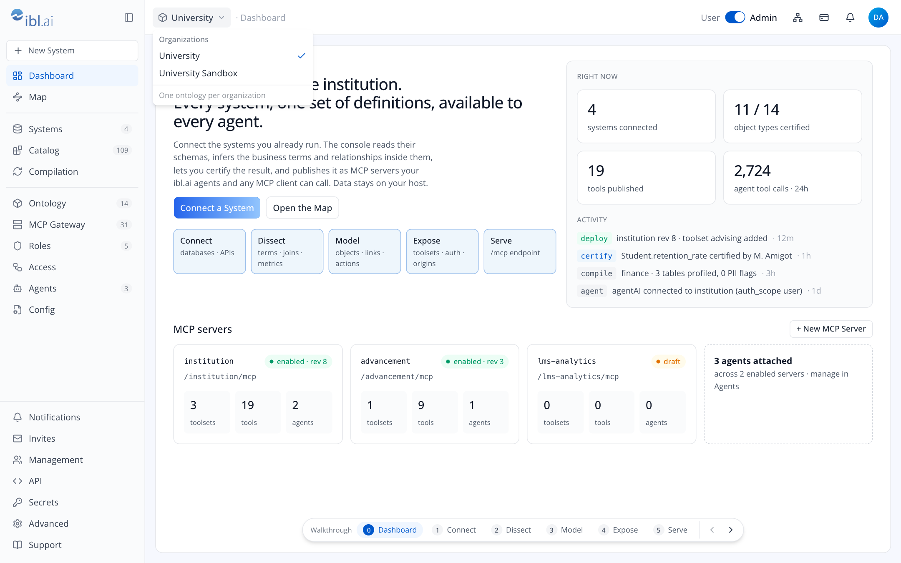

**Sidebar footer.** The same items as os.ibl.ai, and they behave the same way:

| Item          | Opens                                                                                  | Who sees it          |
| ------------- | -------------------------------------------------------------------------------------- | -------------------- |
| Notifications | the Notifications page (SDK notification center)                                       | everyone             |
| Invites       | the SDK invite dialog                                                                  | admins in Admin mode |
| Management    | dialog with the SDK `Admin` surface: users, groups, roles, policies, teams, alerts     | admins in Admin mode |
| API           | dialog with the SDK `ApiTab`: platform API tokens                                      | admins in Admin mode |
| Secrets       | dialog with the SDK `SecretsTab`: LLM keys, service credentials, environment variables | admins in Admin mode |
| Advanced      | dialog with the SDK `AdvancedTab`: organization settings                               | admins in Admin mode |
| Support       | docs.ibl.ai in a new tab                                                               | everyone             |

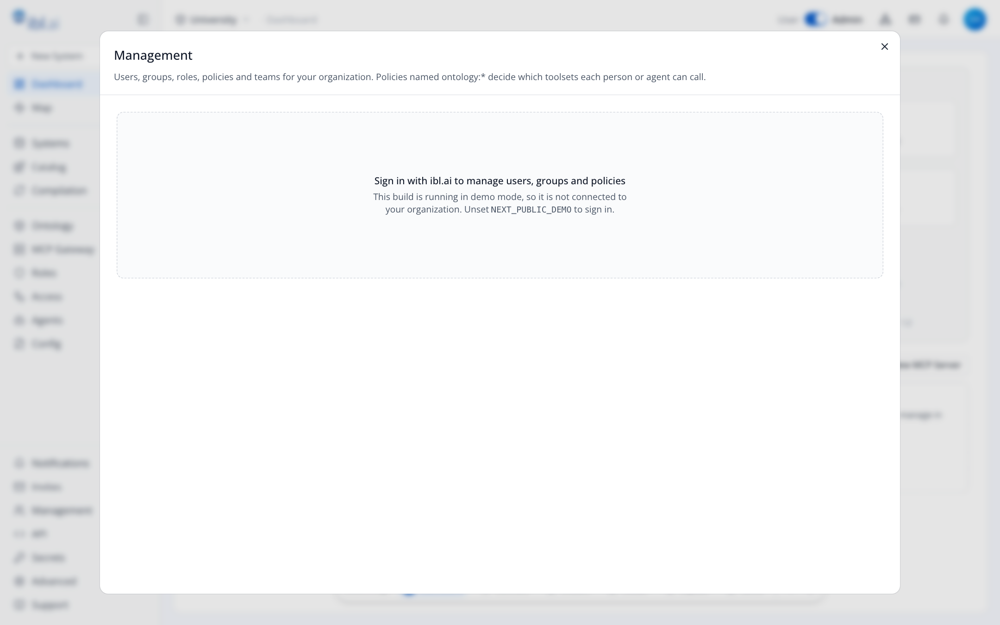

The screenshot is from demo mode, where SDK panels show a sign-in notice; signed in, the dialog
holds the live SDK component.

**Collapse.** The button next to the logo collapses the sidebar to an icon rail (labels on hover)
and remembers the choice per browser.

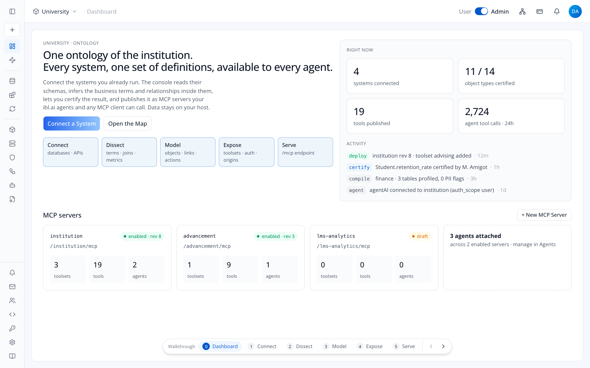

**Phone and tablet.** Below 768px the sidebar becomes a drawer behind the menu button; every page
reflows to one column, tables and code scroll inside their own box, and nothing scrolls sideways.

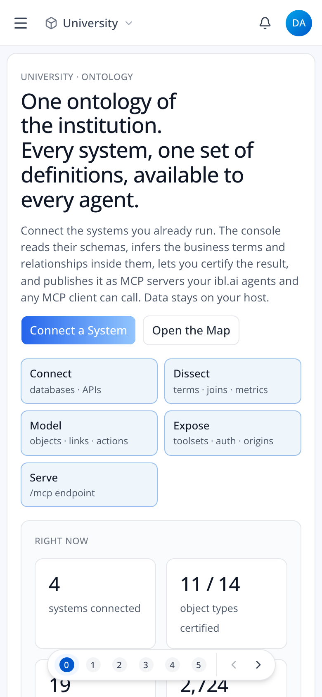 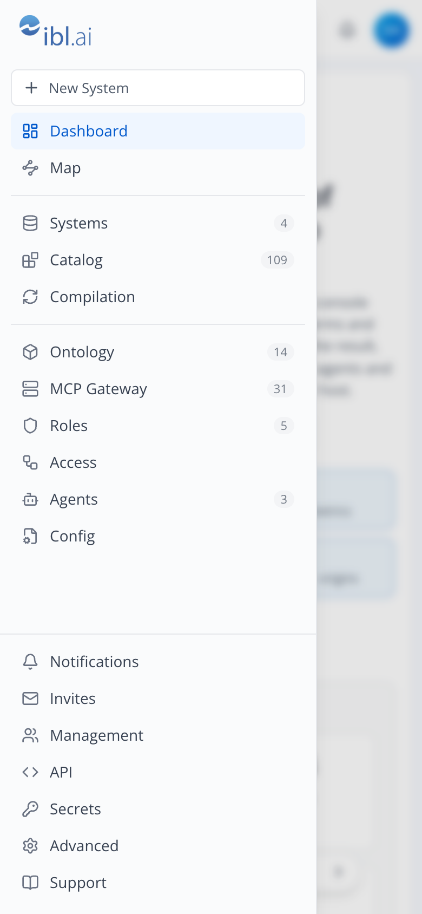

Every page is checked at 375, 768, 1024, 1280, 1440 and 1920px by `scripts/audit-layout.mjs`
for content outside its card, text overflowing its box, overlapping siblings and sideways scrolling.

## Dashboard

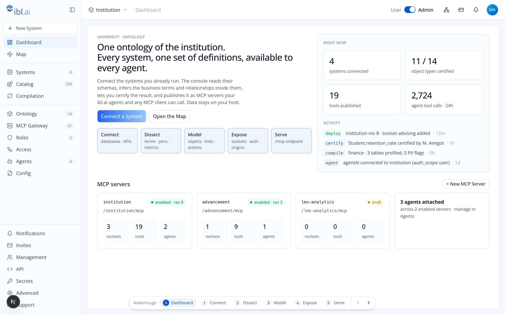

The organization's ontology at a glance. Four counters: systems connected (from the engine's
connections), object types certified out of total (engine terms), tools published (count across
server configs) and agent tool calls in the last 24 hours (ibl.ai analytics). The activity feed
merges three sources: config deploys on the host, certifications in the engine, and agent
attachments on ibl.ai. Below, one card per MCP server with its revision, toolsets, tools and attached
agents, and a shortcut to Agents.

**Connect a System** starts step 1; **Open the Map** jumps to the live graph.

## Step 1 · Systems

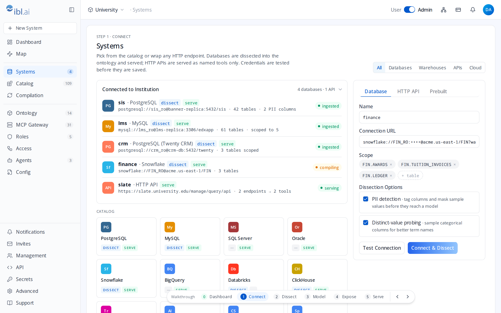

Left: the systems already connected, each with its engine, read-only URL, table count, PII column
count and ingest status, plus any HTTP APIs served as tools. Under it, the catalog of source kinds,
filterable by Databases, Warehouses, APIs and Cloud. Each kind carries two badges: **DISSECT**
(the engine can infer terms from it) and **SERVE** (the runtime can expose it).

Right: the add panel. **Database** takes a name, a connection URL, a table scope and the two
dissection options (PII detection, distinct-value probing). **Test Connection** validates the
credentials through the engine. **Connect & Dissect** registers the connection, starts ingestion and
compilation, and opens the Map.

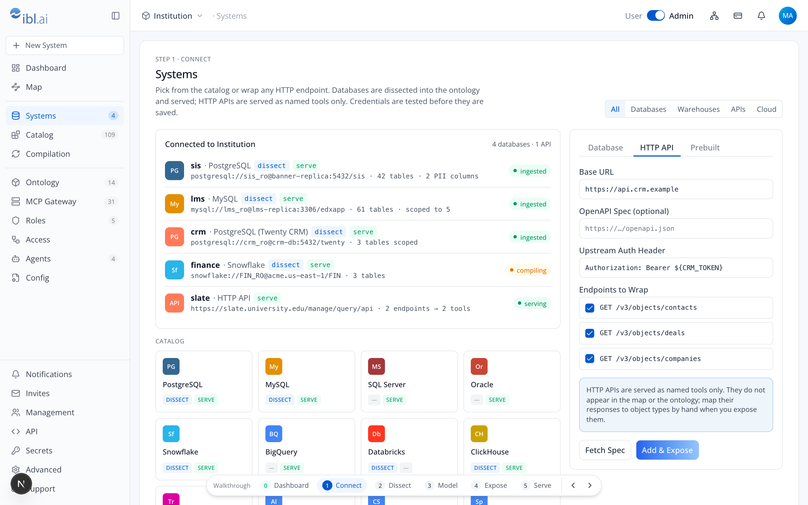

**HTTP API** takes a base URL, an optional OpenAPI spec, the upstream auth header (resolved from the
host's env file) and the endpoints to wrap. APIs are served only, never dissected, so this tab ends
in **Add & Expose** rather than in the Map. **Prebuilt** lists the runtime's ready-made toolsets per
engine for analysts who need raw SQL.

## Step 2 · Map

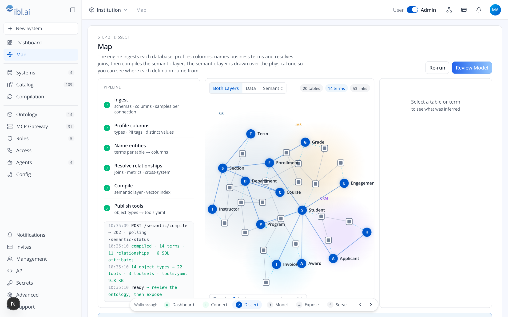

The dissection, live. Left: the pipeline (Ingest → Profile columns → Name entities → Resolve
relationships → Compile → Publish tools) with the engine's log underneath; stage state comes from
the engine's ingest and compile status, the lines from its service log.

Center: the graph. Square nodes are tables, clustered and tinted by system; round blue nodes are the
business terms the engine named. Dashed blue lines map a term to the tables that back it; solid blue
lines are relationships between terms; grey lines are foreign keys. Toggle **Both Layers / Data /
Semantic**, drag nodes, hover for labels, click for detail.

Below 1536px the graph and inspector sit side by side and the pipeline moves underneath them; on
phones they stack.

Right: the inspector. For a table: rows profiled, columns with inferred kinds and PII tags, joins,
and the term it maps to. For a term: description, synonyms, the tables it maps to with their system,
the SQL attributes inferred for it, and the tools it will become. **Certify** and **Edit in
Ontology** act on the engine's term.

When a term spans several systems (Student across SIS, LMS and CRM) a banner calls it out with
**Open Term** and **Certify Student**.

## Step 3 · Ontology

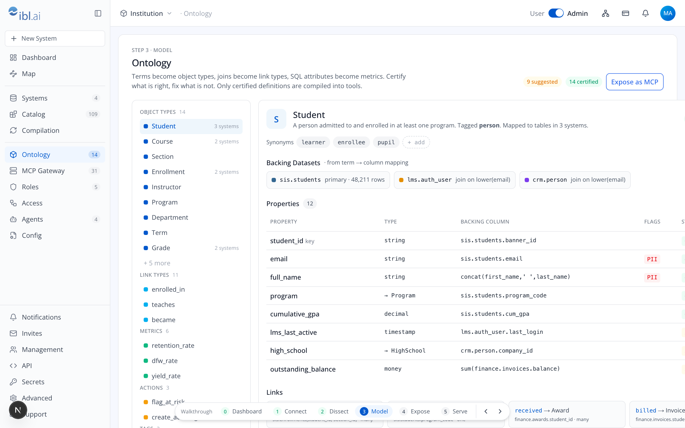

The ontology manager. Left: object types (terms), link types (relationships), metrics (SQL
attributes), actions (write tools) and tags, each with counts; suggested items are marked **new**.

Right, for the selected object type: description and synonyms, **Backing Datasets** (the tables that
back it, per system, with the join), **Properties** (name, type, backing column or expression, PII
flag, certified/suggested), **Links** to other object types with the physical path, **Metrics** with
their certified SQL expression and grain, and **Actions**, the write tools declared in the server
config with the toolset that gates them.

**Expose as MCP** opens the server builder with the certified set.

## Step 4 · MCP Gateway · New MCP Server

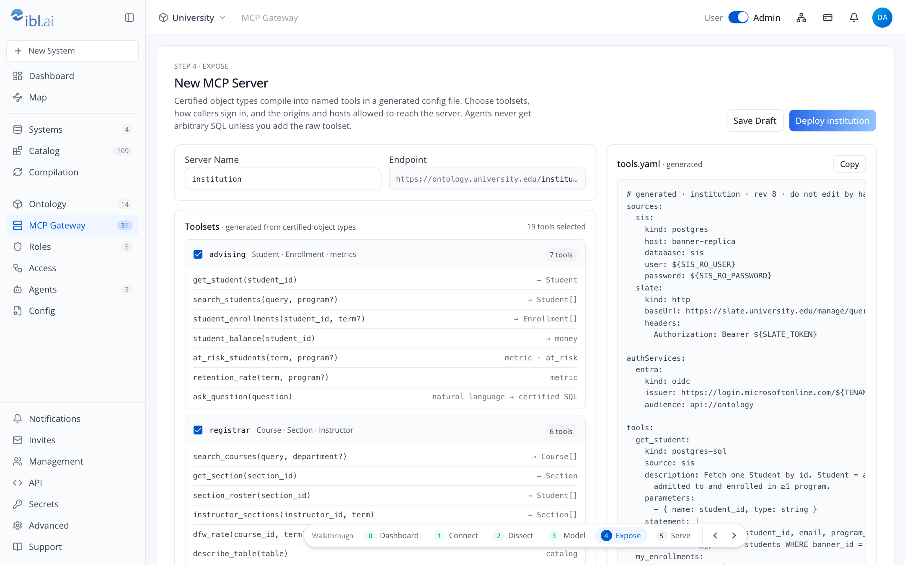

Left column, top to bottom:

- **Server Name** and the resulting endpoint.
- **Toolsets**, generated from certified object types and metrics. Each toolset lists its tools with
  signatures and what they return; write toolsets show a **writes** badge, the prebuilt raw toolset
  shows **unrestricted reads**. Untick what this server should not offer.
- **Authentication**: ibl.ai Platform Tokens (verified with ibl.ai by the gateway; **Issue Token**
  creates one on ibl.ai), Microsoft Entra ID, Google Sign-in and Custom OIDC Issuer (verified by the
  runtime itself).
- **Allowed Origins** (chips, add or remove) and **Allowed Hosts**, both passed to the runtime as
  flags.

Right column: the generated config file exactly as it will be written to the host.

**Deploy** writes the files, starts the runtime process and registers the server on ibl.ai.

## Step 5 · MCP Gateway · Server

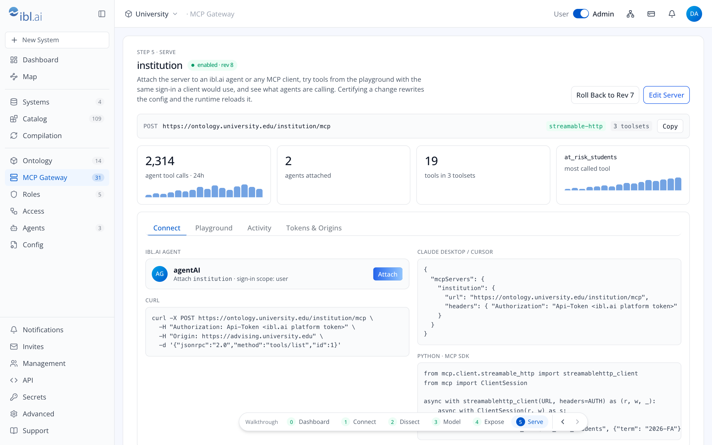

The endpoint with a copy button, then four counters: agent tool calls in 24 h, agents attached, tools
across toolsets, most called tool.

**Connect**: attach the server to an ibl.ai agent in one click, plus ready-to-paste snippets for
cURL, Claude Desktop / Cursor and the Python MCP SDK.

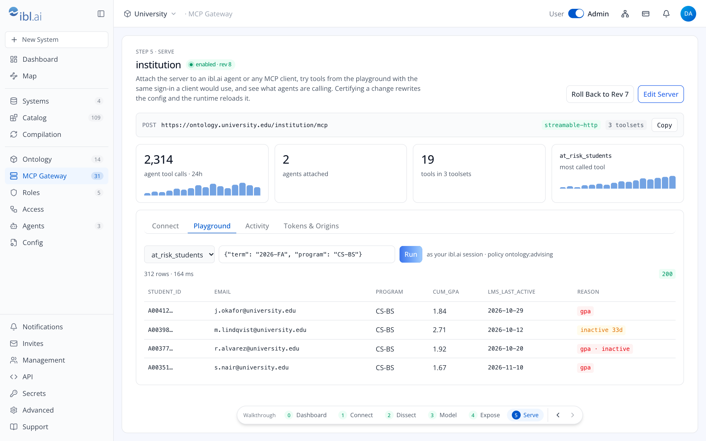

**Playground**: pick a tool, edit its arguments as JSON, **Run**. The call goes through the gateway
with your own ibl.ai session, so you see exactly what an agent with your policy would see.
`ask_question` returns an answer, the certified SQL it ran and the provenance.

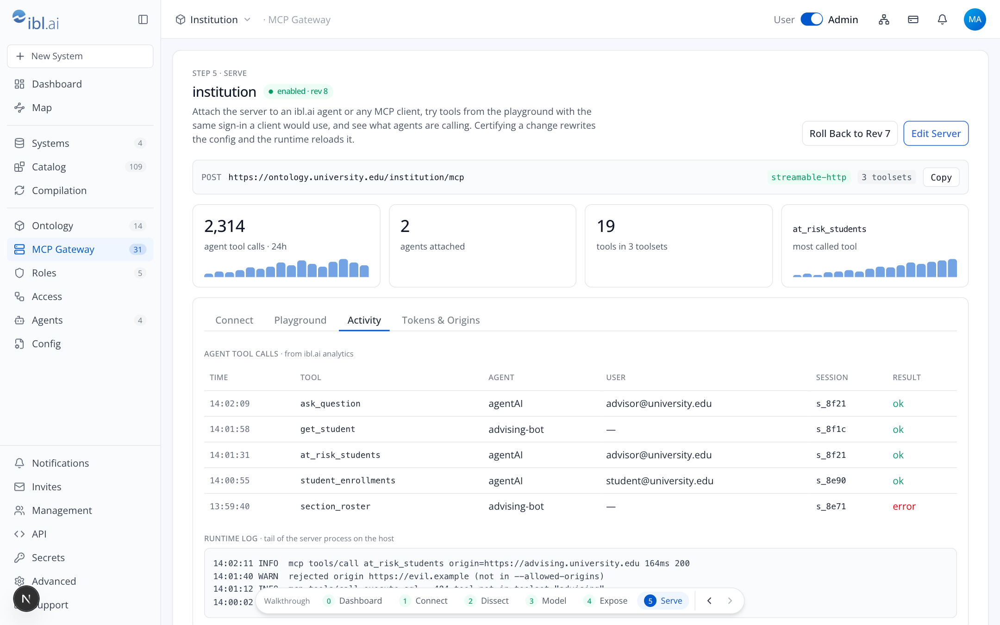

**Activity**: agent tool calls from ibl.ai analytics (tool, agent, user, session, result), and a
tail of the runtime log on the host, which is where origin rejections and direct client calls show.

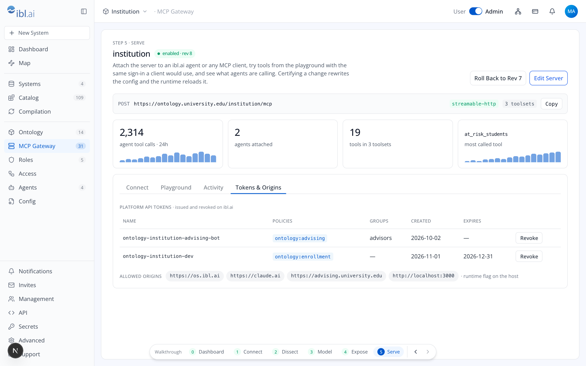

**Tokens & Origins**: the ibl.ai platform tokens that carry an `ontology:*` policy, with their
policies, groups, created and expiry dates and a **Revoke** button, and the server's allowed origins.

## MCP Servers

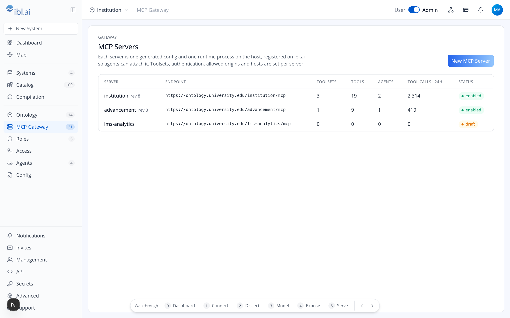

All servers of the organization: endpoint, toolsets, tools, attached agents, tool calls and status.

## Agents

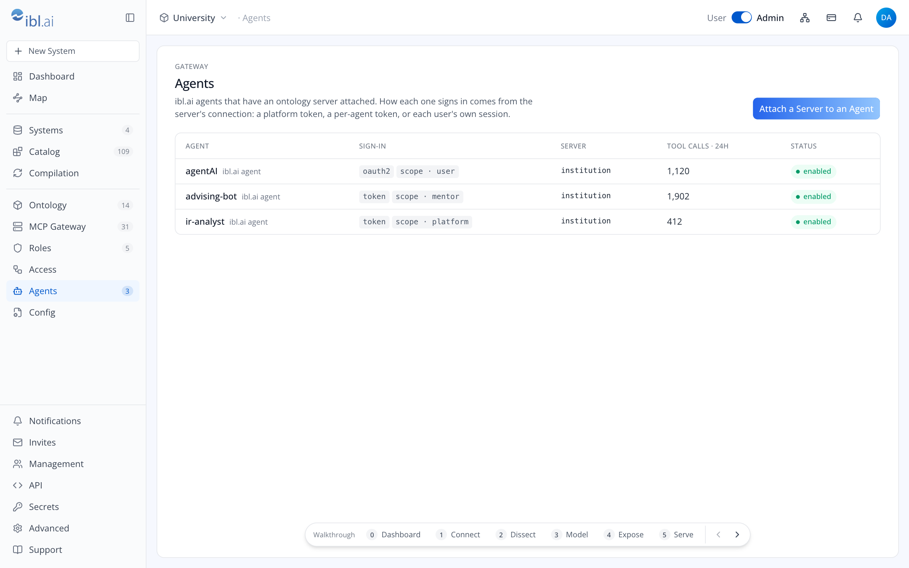

ibl.ai agents that have an ontology server attached, how each signs in (token or OAuth, and the
scope: platform, per-agent or per-user), the server, and call counts.

## Roles and Access

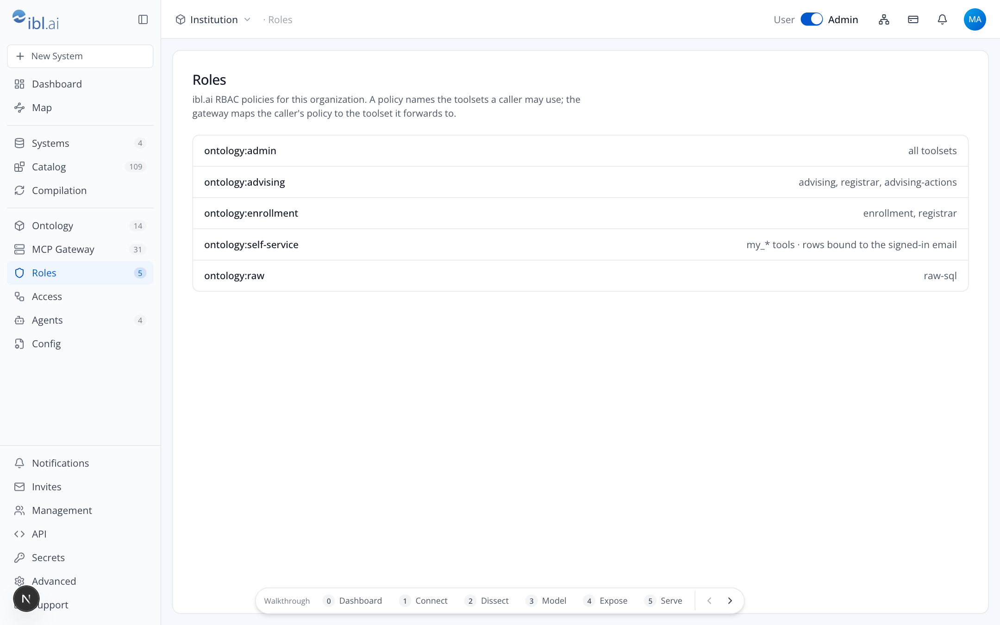

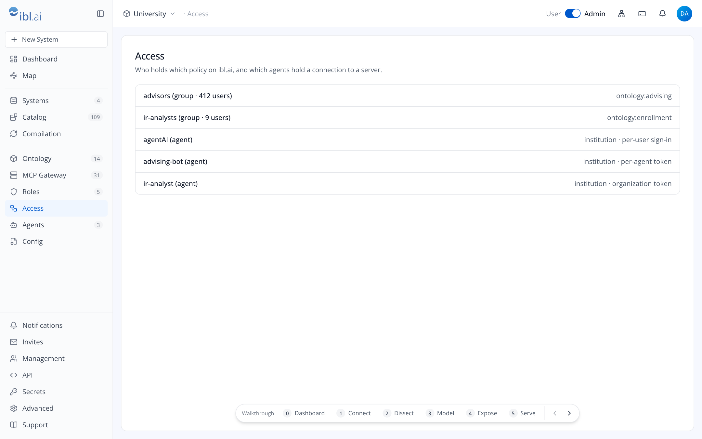

**Roles** lists the ibl.ai RBAC policies and the toolsets each maps to. **Access** lists which
groups and agents hold which policy. Both are views of ibl.ai; changes are made there.

## Catalog, Compilation, Config

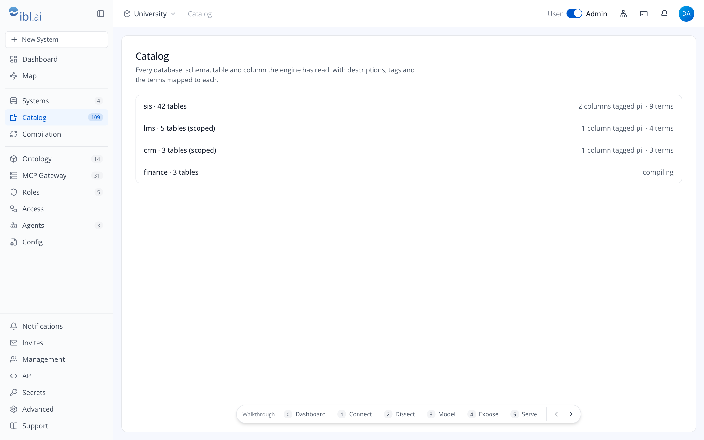

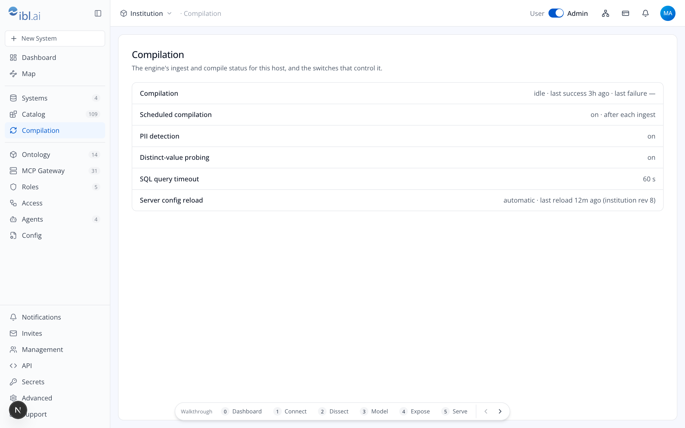

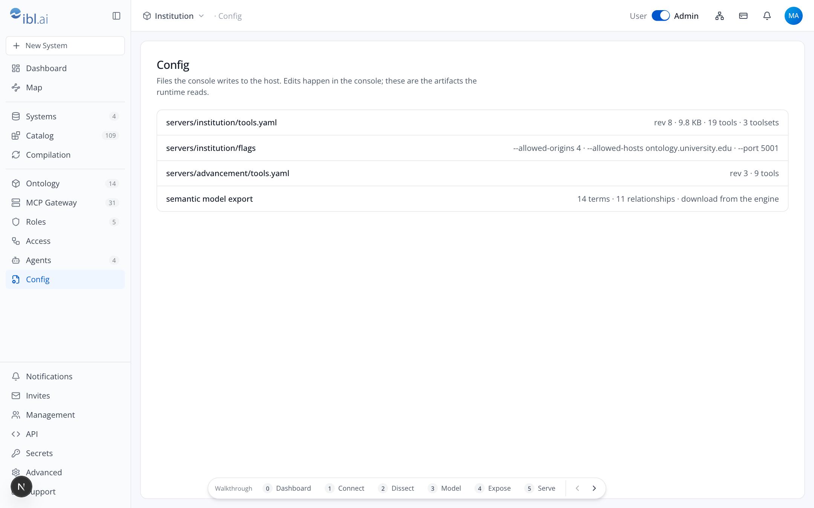

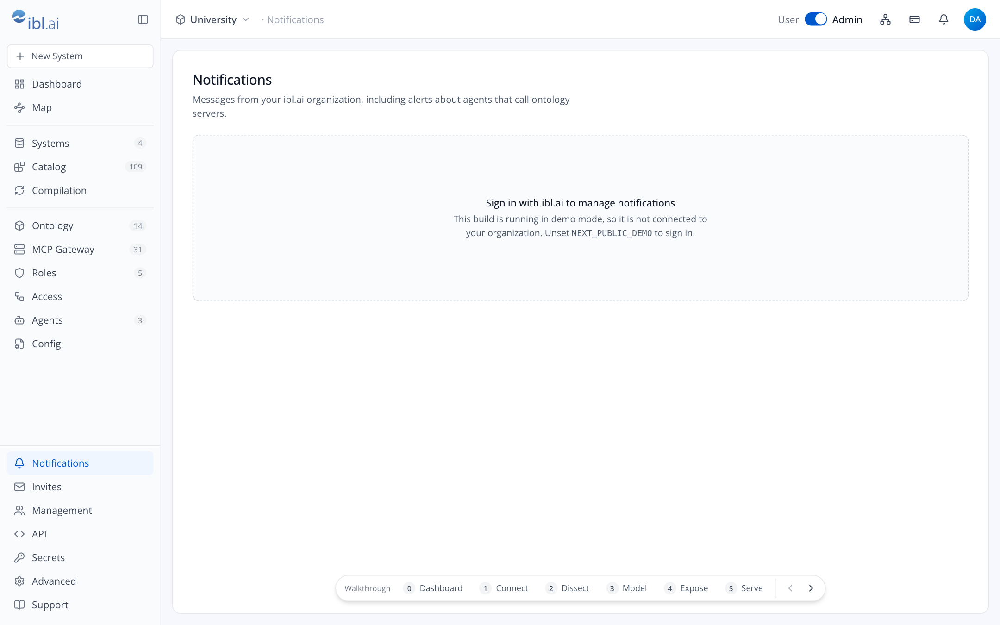

**Catalog**: every database, schema, table and column the engine read, with tags and mapped terms.
**Compilation**: the engine's run status and its switches. **Config**: the files the console writes
to the host, per server, with revisions.
