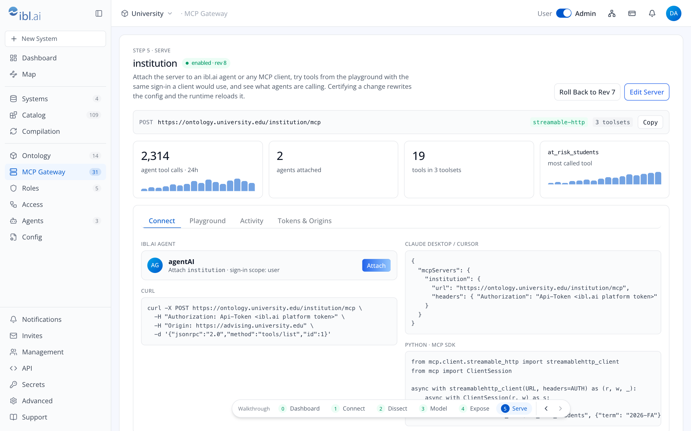

# Guide: connecting agents and clients

Every server has one endpoint, `https://<host>/<slug>/mcp`, speaking MCP over streamable HTTP.
Anything that speaks MCP can use it, provided it can reach the host (VPN or ibl.ai egress) and
presents a credential the server accepts ([permissions.md](permissions.md)).



## ibl.ai OS agents

Deploying a server registers it on ibl.ai as an MCP server for your organization
(`name`, `url`, `transport: streamable-http`, `auth_type`, `auth_scope`). From there:

1. Open the server in the console, **Connect → ibl.ai agent → Attach**, or in os.ibl.ai open the
   agent's **Tools / MCP connectors** and enable the server.
2. Choose the **sign-in scope** for that agent:
   - `platform` or `mentor`: the console issues a platform token with the right policy and stores it
     in the agent's MCP server connection on ibl.ai. Nothing to do in chat.
   - `user`: each person authenticates once in chat; ibl.ai keeps that grant and sends it on every
     call. Pair with an OIDC auth service on the server when rows must be bound to the person.
3. Verify from the agent: ask "what tools do you have from institution?" and then a real question.
   The call appears under the server's **Activity** tab within a minute.

The agent only ever talks to ibl.ai; ibl.ai talks to your host. Allow ibl.ai's egress addresses
inbound on 443 ([network.md](../network.md)).

## Claude Desktop and Claude Code

Both read a `mcpServers` map. The person must be on the VPN and hold a platform token issued to
them on ibl.ai (**MCP Gateway → server → Tokens & Origins → Issue Token**, or **API** in the OS).

Claude Desktop (`claude_desktop_config.json`):

```json
{
  "mcpServers": {
    "institution": {
      "url": "https://ontology.university.edu/institution/mcp",
      "headers": { "Authorization": "Api-Token <token>" }
    }
  }
}
```

Claude Code:

```bash
claude mcp add --transport http institution https://ontology.university.edu/institution/mcp \
  --header "Authorization: Api-Token <token>"
```

With an Entra auth service on the server, omit the header and let the client run the OAuth flow the
runtime advertises; the runtime verifies the resulting token itself.

## Codex CLI

`~/.codex/config.toml`:

```toml
[mcp_servers.institution]
url = "https://ontology.university.edu/institution/mcp"
http_headers = { Authorization = "Api-Token <token>" }
```

Keep the token out of the file if you can: put it in an environment variable and reference it the
way your Codex version supports (`bearer_token_env_var` on recent releases, which sends
`Authorization: Bearer`; in that case add `Bearer` to the accepted schemes on the server, or use
`http_headers` as above).

## Cursor, Windsurf, other editors

Same shape as Claude Desktop: a `url` plus an `Authorization` header. Editors that only support
stdio can bridge with `mcp-remote`:

```json
{
  "mcpServers": {
    "institution": {
      "command": "npx",
      "args": [
        "mcp-remote",
        "https://ontology.university.edu/institution/mcp",
        "--header",
        "Authorization: Api-Token <token>"
      ]
    }
  }
}
```

## Your own code

Python, official MCP SDK:

```python
from mcp import ClientSession
from mcp.client.streamable_http import streamablehttp_client

URL = "https://ontology.university.edu/institution/mcp"
AUTH = {"Authorization": "Api-Token " + os.environ["ONTOLOGY_TOKEN"]}

async with streamablehttp_client(URL, headers=AUTH) as (read, write, _):
    async with ClientSession(read, write) as s:
        await s.initialize()
        tools = await s.list_tools()
        rows = await s.call_tool("at_risk_students", {"term": "2026-FA"})
```

Smoke test with cURL:

```bash
curl -sS -X POST https://ontology.university.edu/institution/mcp \
  -H "Authorization: Api-Token $ONTOLOGY_TOKEN" \
  -H "Content-Type: application/json" \
  -d '{"jsonrpc":"2.0","id":1,"method":"tools/list"}'
```

## Browser-based agents and apps

claude.ai, os.ibl.ai and your own web apps call from a browser and send an `Origin` header. Add
each origin under **Allowed Origins** on the server, or the gateway refuses the call before it looks
at the token.

## What a caller sees

- `tools/list` returns only the tools in the toolsets the caller's policies map to. Two people with
  different policies see different lists from the same URL.
- Tool descriptions carry the certified definition of the term ("Student = a person admitted to and
  enrolled in ≥1 program"), which is what makes agents pick the right tool.
- `ask_question` (when included) accepts natural language, answers with certified SQL, and returns
  the SQL and the provenance alongside the rows.

## Troubleshooting

| Response                                 | Meaning                                      | Fix                                       |
| ---------------------------------------- | -------------------------------------------- | ----------------------------------------- |
| `403 origin`                             | browser origin not allowed                   | add it under Allowed Origins and redeploy |
| `401`                                    | token missing, expired or revoked            | issue a new platform token on ibl.ai      |
| `403 no policy`                          | token valid but holds no `ontology:*` policy | attach a policy to the token or its group |
| `404 tool not in toolset`                | the tool exists but not for this policy      | grant the policy that includes it         |
| timeout from an ibl.ai agent             | ibl.ai egress not allowed inbound            | firewall rule for ibl.ai egress on 443    |
| works with cURL, not from Claude Desktop | client not on the VPN                        | connect to the VPN first                  |
