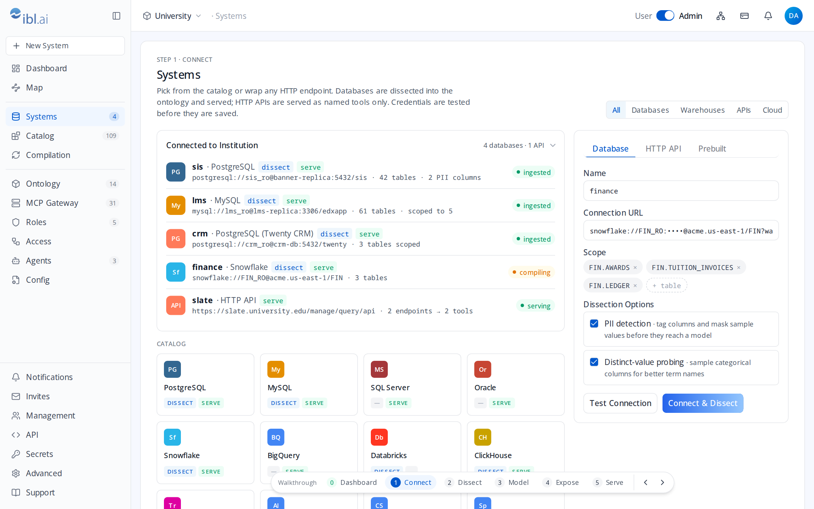
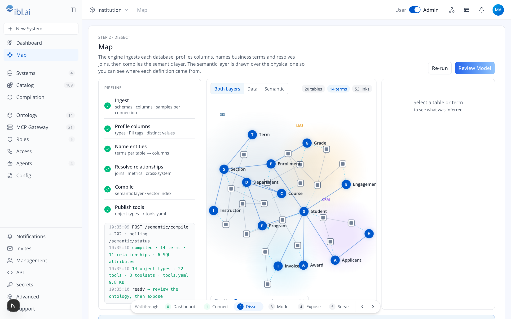
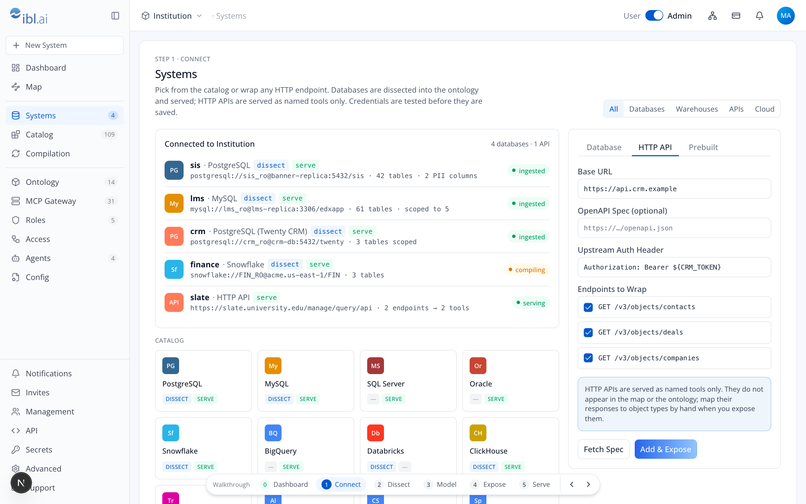

# Guide: adding data sources

A data source is either a **database** (dissected into the ontology and served) or an **HTTP API**
(served as named tools only). Both are added from **Systems**.



## Before you start

1. **A read-only login.** The engine profiles tables and samples rows; the server runs the SQL in
   certified tools. Neither needs write access. Create a dedicated role:

   ```sql
   -- PostgreSQL
   CREATE ROLE ontology_ro LOGIN PASSWORD '…';
   GRANT CONNECT ON DATABASE sis TO ontology_ro;
   GRANT USAGE ON SCHEMA public TO ontology_ro;
   GRANT SELECT ON ALL TABLES IN SCHEMA public TO ontology_ro;
   ALTER DEFAULT PRIVILEGES IN SCHEMA public GRANT SELECT ON TABLES TO ontology_ro;
   ```

   ```sql
   -- MySQL
   CREATE USER 'ontology_ro'@'%' IDENTIFIED BY '…';
   GRANT SELECT ON edxapp.* TO 'ontology_ro'@'%';
   ```

   Snowflake: a role with `USAGE` on the warehouse, database and schema, `SELECT` on the tables.
   Prefer a **replica** or a reporting copy for transactional systems.

2. **Network path.** The ontology host must reach the database host and port
   ([network.md](../network.md)). Add the host's IP to the database's allow-list.

3. **Scope.** Decide which schemas and tables matter. Dissecting 61 LMS tables when five carry
   the meaning only slows compilation and adds noise.

## Adding a database


1. Open **Systems** and pick the engine in the catalog, or press **New System** in the sidebar.
   The catalog shows two capabilities per kind:
   - **DISSECT** the engine can read it and infer terms (PostgreSQL, MySQL, Snowflake, ClickHouse,
     Trino, Databricks, AlloyDB, Cloud SQL, …).
   - **SERVE** the server runtime can expose it as tools (almost everything).
     A kind with SERVE only (SQL Server, Oracle, BigQuery, MongoDB, …) can still be exposed through
     hand-written tools, but it will not appear in the map.
2. Fill in **Name** (short, lower-case; it becomes the schema prefix you see everywhere, e.g.
   `sis.students`) and the **Connection URL** with the read-only login.
3. **Scope**: add the tables or schemas to include. Everything else is ignored.
4. **Dissection Options**
   - _PII detection_ tags columns that look personal (email, names, identifiers) and masks their
     sample values before any sample reaches a model. Leave it on.
   - _Distinct-value probing_ samples categorical columns so terms get better names
     (`enrollments.status → REGISTERED, DROPPED, WAITLIST, WITHDRAWN`).
5. **Test Connection**. The engine validates the credentials and lists what it can see.
6. **Connect & Dissect**. The console:
   - registers the connection with the engine (`POST /api/connections`, stored in the engine's own
     database, optionally through Vault),
   - triggers ingestion (`POST /ingest`) and then compilation (`POST /semantic/compile`),
   - writes the same connection as a `source` in the server config on the host, reading the password
     from `/srv/ontology/servers/<slug>/env`, so the credential exists in exactly two places on the
     host and nowhere else.
     You land on **Map**, which follows the run.



7. When the pipeline reaches **Compile**, the tables appear in the map clustered by system, and the
   terms the engine named float above them. Click any node to see what was inferred. Terms that span
   several systems (the same Student in SIS, LMS and CRM) are called out for certification.

## Adding an HTTP API



HTTP APIs are not dissected. The runtime calls them live, as named tools, with an upstream credential
that never leaves the host.

1. **Systems → HTTP API** tab. Enter the **Base URL** and, if there is one, the **OpenAPI Spec** URL
   (each operation becomes a candidate tool with typed parameters).
2. **Upstream Auth Header**: the header the API expects, e.g. `Authorization: Bearer ${SLATE_TOKEN}`.
   The `${…}` name is resolved from the server's `env` file on the host.
3. Tick the **Endpoints to Wrap**. Each becomes an `http` tool with `method`, `path`, and
   `queryParams` / `pathParams` / `requestBody` derived from the spec.
4. **Add & Expose** takes you to the server builder, where you place the new tools in a toolset.

Because APIs do not pass through the engine, their responses are not object types. If an endpoint
returns something the ontology already models (an applicant, a course), say so in the tool's
description so agents connect the two.

## Prebuilt toolsets

The runtime ships ready-made toolsets per engine (`execute_sql`, `list_tables`, …). Add one only for
analyst roles that genuinely need ad-hoc SQL, keep it on the read-only login, and put it in its own
toolset so it can be granted separately (it shows as **unrestricted reads** in the server builder).

## After connecting

- **Catalog** lists every database, schema, table and column the engine read, with tags (PII) and
  the terms mapped to each.
- **Compilation** shows whether a compile is running, when the last one succeeded, and the switches
  (scheduled compilation, PII detection, probing, query timeout).
- **Ontology** is where you review and certify what the engine inferred before it becomes tools
  ([permissions.md](permissions.md) covers who may certify).

## Changing or removing a source

- Rotating a password: update the `env` file on the host and the connection in the engine (Systems →
  the system → Edit). The runtime reloads config on its own.
- Re-scoping tables: edit the scope and re-dissect; terms already certified are kept.
- Removing a system: it is deleted from the engine, its `source` and tools are removed from every
  server config, and the next deploy drops the tools. Agents that relied on them get a clear "tool
  not found" instead of silent nulls.

## Troubleshooting

| Symptom                                     | Likely cause                          | Where to look                                                                         |
| ------------------------------------------- | ------------------------------------- | ------------------------------------------------------------------------------------- |
| Test Connection fails                       | firewall or wrong login               | host can reach `db:port`? `psql`/`mysql` from the host with the same URL              |
| Ingest accepted, nothing appears in the map | compile not finished or failed        | **Compilation** page: `last_failure_at`; engine logs on the host                      |
| Terms are poorly named                      | columns are opaque codes, probing off | turn on distinct-value probing; add column descriptions in **Catalog** and re-compile |
| PII column not tagged                       | detector missed it                    | tag the column `pii` in **Catalog**; tags are honored on the next compile             |
| Tool returns permission error               | login lacks SELECT on a joined table  | grant SELECT; the certified SQL shows the tables involved                             |
