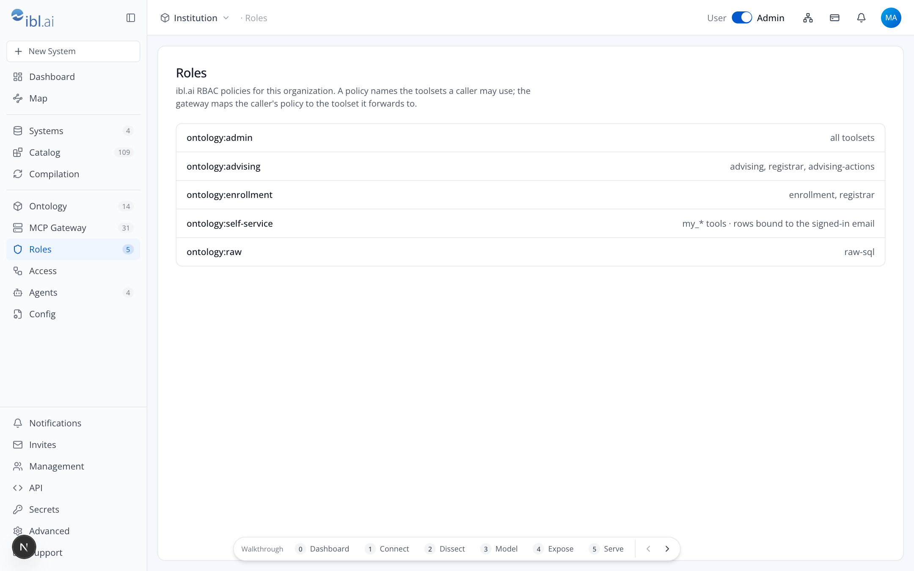
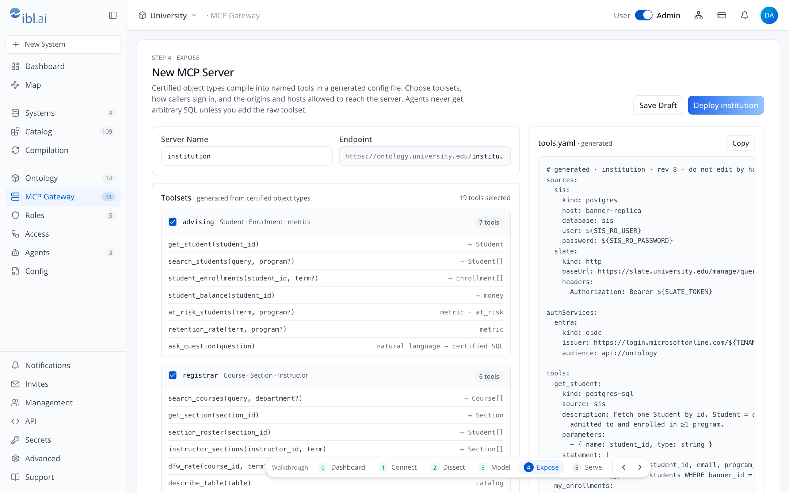

# Guide: permissions

There are three questions, each answered by one system:

| Question                                           | Answered by                                                           | Where you set it                                              |
| -------------------------------------------------- | --------------------------------------------------------------------- | ------------------------------------------------------------- |
| **Who** is calling, and which policy do they hold? | ibl.ai (SSO, RBAC policies, groups, platform tokens)                  | **Roles**, **Access**, ibl.ai OS                              |
| **What** may that policy call?                     | the server config: toolsets named after policies                      | **MCP Gateway → server builder**                              |
| **Which rows** may a call see?                     | the certified SQL and, for OIDC callers, claims bound into parameters | **Ontology** (SQL attributes), server builder (auth services) |

Nothing on the ontology host stores a user, a role or a grant. The gateway asks ibl.ai on every
call.

## 1. Policies ↔ toolsets



A **toolset** is a named list of tools in a server's config. A **policy** is an ibl.ai RBAC policy
for your organization. They share a name, and that is the whole mapping:

| Policy on ibl.ai        | Toolset in `tools.yaml`                     | Who typically holds it            |
| ----------------------- | ------------------------------------------- | --------------------------------- |
| `ontology:admin`        | all toolsets                                | platform admins                   |
| `ontology:advising`     | `advising`, `registrar`, `advising-actions` | advisors group                    |
| `ontology:enrollment`   | `enrollment`, `registrar`                   | admissions and IR analysts        |
| `ontology:self-service` | `self-service` (`my_*` tools)               | every signed-in student via Entra |
| `ontology:raw`          | `raw-sql`                                   | a few analysts, read-only login   |

When a call arrives at `/<slug>/mcp`, the gateway verifies the token with ibl.ai, reads the caller's
policies, picks the matching toolset and forwards to the runtime at `/mcp/<toolset>`. A caller with
two policies sees the union. A caller with none gets `403` before any tool is listed.

Create or edit policies on ibl.ai (**Roles** in this console deep-links to them):
`POST …/api/core/rbac/policies/` with the groups and users that hold it. Group membership is where
day-to-day administration happens; the toolsets rarely change.

## 2. How callers sign in



Set per server, under **Authentication**:

- **ibl.ai Platform Tokens** (`Authorization: Api-Token …`). Issued on ibl.ai, named, scoped to
  policies and groups, revocable. Used by ibl.ai agents (held in the agent's MCP server connection)
  and by people using Claude, Codex or Cursor. **Issue Token** in the console creates one on ibl.ai
  and shows the secret once.
- **Microsoft Entra ID / Google / custom OIDC**. Declared as an auth service in the server config and
  verified by the runtime itself. Use it when individual users should call tools under their own
  identity so rows can be bound to them (next section). The runtime checks signature, audience,
  issuer and expiry.

An ibl.ai agent attached to a server has a **sign-in scope** on ibl.ai:

| Scope      | Meaning                                        | Use when                            |
| ---------- | ---------------------------------------------- | ----------------------------------- |
| `platform` | one token for the whole organization           | a shared, read-only analyst agent   |
| `mentor`   | one token per agent                            | a service agent with its own policy |
| `user`     | each person's own credential, obtained in chat | agents that answer "my enrollments" |

## 3. Row-level restriction

Three mechanisms, from coarse to fine:

1. **Toolset choice.** A policy that never includes `section_roster` cannot read rosters. This is the
   first and strongest line.
2. **Certified SQL.** A tool's statement is fixed. `search_students` may filter to
   `program_code = $1`; it can never be widened by the caller. Write the restriction into the SQL
   attribute and certify it in **Ontology**.
3. **Claim binding** (OIDC callers). A parameter can be taken from the verified token instead of
   the caller's input:

   ```yaml
   my_enrollments:
     kind: postgres-sql
     source: sis
     authRequired: [entra]
     parameters:
       - name: email
         type: string
         authServices:
           - { name: entra, field: email }
     statement: SELECT … FROM enrollments e JOIN students s … WHERE s.email = $1
   ```

   The student cannot supply another email. Put such tools in the `self-service` toolset.

For ibl.ai-token callers the gateway maps policy → toolset only; it does not rewrite parameters. If
you need per-user rows for ibl.ai agents, give the server an OIDC auth service and set the agent's
sign-in scope to `user`.

## 4. PII

Columns the engine tags `pii` (or that you tag in **Catalog**) are visible in **Ontology** with a
red PII flag. Decide per toolset whether tools that return them belong there. A good default:
`advising` returns names and emails, `enrollment` returns counts and aggregates only,
`self-service` returns only the caller's own row.

## 5. Writes

Read-only is the default: every database login the engine and the runtime use should be a
read-only role. Writes happen only through **Actions**, tools you add deliberately:

- a separate database login with the exact grant (`INSERT ON advising_notes`), stored as its own
  entry in the server's `env`,
- a separate toolset (`advising-actions`), shown with a **writes** badge in the builder,
- a separate policy (`ontology:advising` includes it; `ontology:enrollment` does not).

## 6. Origins and hosts


- **Allowed Origins**: browsers and browser-based agents (os.ibl.ai, claude.ai, your own apps) must
  send one of these `Origin` values. Passed to the runtime and enforced by the gateway before
  authentication. Native clients (Claude Desktop, Codex CLI) send no `Origin` and are unaffected.
- **Allowed Hosts**: the DNS names the server answers to (`ontology.university.edu`). Blocks DNS
  rebinding.

## 7. Who may do what in the console

The console itself is an ibl.ai app. Its pages require the ibl.ai **admin** mode (the User/Admin
switch in the header), and the host route handlers refuse any session that is not an organization
admin. Suggested split, enforced through ibl.ai RBAC:

| Task                                    | Needs                                                       |
| --------------------------------------- | ----------------------------------------------------------- |
| Add or edit a system, run dissection    | org admin                                                   |
| Certify terms and metrics               | org admin, or a `ontology:steward` policy if you create one |
| Build and deploy a server, issue tokens | org admin                                                   |
| Attach a server to an agent             | the agent's owner, per ibl.ai agent access rules            |

## 8. Audit

| What                                                                      | Where                                                                                            |
| ------------------------------------------------------------------------- | ------------------------------------------------------------------------------------------------ |
| Every tool call an ibl.ai agent made (tool, input, output, user, session) | ibl.ai analytics; shown under the server's **Activity** tab                                      |
| Direct calls from Claude, Codex, cURL, origin rejections, toolset misses  | the runtime's stdout on the host; tail shown under **Activity → Runtime Log**; ship to your SIEM |
| Who changed a term, when                                                  | engine term records (`modified_by`)                                                              |
| Who deployed which config revision                                        | file history under `/srv/ontology/servers/<slug>/`                                               |
| Token creation and revocation, policy changes                             | ibl.ai audit logs                                                                                |
