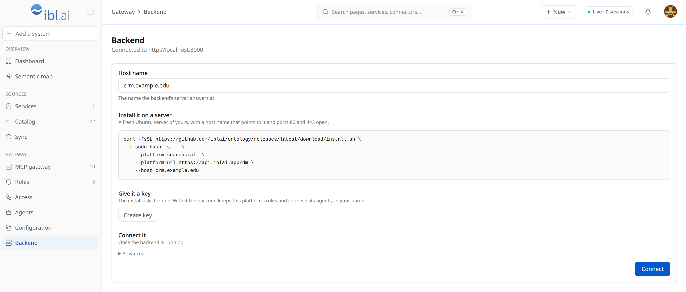

# Install ibl.ai Ontology on your server

For the administrator of an ibl.ai platform who sets up the Ontology Backend on a server of their
own. It shows the one command, what it asks and prints, what ends up on the server, and how the
whole thing is configured afterwards.

The frontend, **ibl.ai Ontology**, is at `https://ontology.ibl.ai` and will be available soon. It
walks you through the same steps on its **Connect a backend** screen. This page is the long
version.

## What you end up with

| Where | What |
|---|---|
| Your server | The Ontology Backend: the gateway your agents call, the sync worker, a database with the synced copy of your systems, the search index and an HTTPS proxy. All of it runs in Docker. |
| Your ibl.ai platform | The roles that say what an agent may reach, the backend's key, and one key per agent you connect. |
| ibl.ai Ontology | The frontend you manage it from. It runs nothing of yours: it sends what you do to your server. |

## Before you start

- **A server**: Ubuntu 22.04 or later, amd64, with root access. A fresh one is best. The script
  installs Docker if it is missing; besides that it adds one folder, `/opt/iblai-ontology`, and
  Docker's own volumes and images. No firewall rule is changed.
- **A host name** that points to the server, such as `ontology.example.edu`. Create the DNS record
  first: the certificate cannot be issued until the name resolves to the server.
- **Ports 80 and 443 open to the internet.** 80 is used for the certificate and to send http on to
  https; everything else goes over 443. ibl.ai Ontology and your platform call from addresses that
  change, so they cannot be let in by address; every call is checked by sign-in or key instead.
- **Outbound https** from the server to your ibl.ai platform, to the systems you will connect, and
  to GitHub and `ghcr.io` for the install itself.
- **An administrator's sign-in** on your ibl.ai platform.

## Step 1. In the frontend: name the server and make its key

1. Sign in on `https://ontology.ibl.ai` (available soon) as an administrator of your platform. A
   platform with no backend yet opens on **Connect a backend**.
2. Type the server's **host name**. The install command below it fills in with your platform and
   that host name.
3. Press **Create key**. The key is shown once: keep the page open, you paste it in step 2. It is
   a platform API key that acts as you, and the backend uses it to keep your platform's roles and
   to connect your agents.



## Step 2. On the server: run the command

Copy the command from the frontend. It has this shape:

```bash
curl -fsSL https://github.com/iblai/ontology/releases/latest/download/install.sh \
  | sudo bash -s -- \
    --platform <your platform's key> \
    --host <your server's host name>
```

To read the script before running it, download it first:
`curl -fsSL https://github.com/iblai/ontology/releases/latest/download/install.sh | less`.

The one thing it asks is the key, at a prompt that does not show what you paste. What it prints,
with Docker's own output left out (this is the script's text, on a fresh server and a platform that
keeps no ontology records yet; a server that has Docker starts with "Docker with Compose is already
here: nothing to install."):

```text
Installing Docker and Compose from Ubuntu's own archive (docker.io, docker-compose-v2).
The backend's key (Connect a backend > Create key; it is not shown as you paste):
The platform takes the key, and its administrators can grant ontology roles.
This platform keeps no ontology records yet: the connected systems and the schedules will
live on this server. The roles still live in the platform.
Writing /opt/iblai-ontology/.env (readable by root alone).
Getting compose.yaml of version <version> and the images.
Starting the backend.
Waiting for https://ontology.example.edu/mcp: the certificate comes first (up to 3 minutes).

The ontology backend is running (version <version>).

  Enter in the frontend, under Connect a backend:    ontology.example.edu
  The address agents call:                           https://ontology.example.edu/mcp

  Its two files:   /opt/iblai-ontology/compose.yaml
                   /opt/iblai-ontology/.env
  Keep a copy of .env somewhere safe: its key decrypts the logins of the connected systems.
  The connected systems and the schedules live on this server; only the roles are in the ibl.ai platform.

  Logs:      docker compose -f /opt/iblai-ontology/compose.yaml logs --follow
  Upgrade:   run the install command again
  Remove:    run it with --uninstall
```

What it does, in order:

1. **Checks the server**: root, Ubuntu 22.04 or later, amd64. Otherwise it stops and says why.
2. **Docker**: uses the one that is there. With none, it installs `docker.io` and
   `docker-compose-v2` from Ubuntu's own archive; no repository or key file is added.
3. **Asks for the key**, and for the platform and the host name if the command did not carry
   them.
4. **Asks your platform two things with that key, before it writes anything.** Whether your
   administrators can grant ontology roles: if not, it stops with the platform's own words. And
   whether the platform keeps ontology records: the answer decides where your settings live (see
   [Where things are kept](#where-things-are-kept)).
5. **Writes `/opt/iblai-ontology/.env`**, readable by root alone, with four secrets it generates.
6. **Downloads `compose.yaml`** of the same release beside it and pulls the images.
7. **Starts the backend** and waits up to three minutes for `https://<host name>/mcp` to answer.
8. **Says what to do next.**

To see every step without changing anything, add `--dry-run`: it asks nothing and prints what it
would do.

## Step 3. In the frontend: connect

Back on **Connect a backend**, the host name is still filled in: press **Connect**. The frontend
checks that the backend answers at `https://<host name>` and takes your sign-in, then opens its
pages. If your backend answers at another address (a port, a path), give it under **Advanced**.


On another computer, ibl.ai Ontology asks for the host name once more: enter it and press Connect.

## Step 4. Connect a system

**Add a system** → pick it → give what it asks → **Connect**.


- **Twenty CRM**: "Twenty cloud" or "Self-hosted" with its address, and an API key from Twenty's
  Settings → APIs. The key is tried on the spot. Its records start arriving at once, and a role
  named after the system now exists that may read those records and change them.
- **A database** (PostgreSQL, MySQL, Oracle, SQL Server, Snowflake and others): its host, port, a
  read-only login and the database. You then see its structure, run the read-only test and approve
  it before anything is synced.


## Step 5. Connect an agent

**Agents** → **Connect an agent** → pick one of your platform's agents and a role → **Connect**.


The frontend makes a key that carries that role and nothing more, registers your server on that
agent, and switches the agent's MCP tool on. The agent can then list the tables it may query,
query them, and, with a role that allows it, create and update records through named operations
(for Twenty CRM: people, companies, opportunities, notes and tasks; nothing is deleted). Each
change is recorded before it runs. **Remove** on the same page deletes the key, so the agent's
access ends at once.


## How it is configured

### The two files

Everything the install leaves outside Docker is one folder:

| File | What it is |
|---|---|
| `/opt/iblai-ontology/compose.yaml` | What runs, as shipped by the release. An upgrade replaces it; do not edit it. |
| `/opt/iblai-ontology/.env` | This server's own settings and secrets. An upgrade never changes it. |

### The settings in `.env`

| Setting | Comes from | What it does |
|---|---|---|
| `ONTOLOGY_HOST` | `--host` | The server's host name: the certificate is issued for it, and agents call `https://<it>/mcp`. |
| `IBLAI_BASE_URL` | Set by the install | The ibl.ai platform's address, `https://api.iblai.app/dm`: where every sign-in and key is checked, and where the roles are kept. |
| `IBLAI_ORG` | `--platform` | Your platform's key. Only its administrators get into the frontend, and only its credentials are taken by the gateway. |
| `IBLAI_ADMIN_TOKEN` | The key you pasted | The backend's platform API key. With it the backend writes the roles, registers itself on an agent and switches that agent's MCP tool on. |
| `ONTOLOGY_DATA_STORE` | The platform's answer at install | `rbac`: the connected systems and schedules are kept on this server. `dm`: the platform keeps them. The roles are in the platform either way. |
| `ONTOLOGY_DB_PASSWORD` | Generated | The password of the server's own database. |
| `CHROMA_TOKEN` | Generated | The token of the search index. |
| `ONTOLOGY_SECRET_KEY` | Generated | The backend's signing secret. |
| `ONTOLOGY_CREDENTIAL_KEY` | Generated | Encrypts the logins and API keys of the systems you connect. Without it they must be entered again: **keep a copy of `.env` somewhere safe.** |

To change one (a new host name, a new key from the frontend's **Backend** page), edit the file and
apply it:

```bash
sudo docker compose -f /opt/iblai-ontology/compose.yaml up --detach
```

After a change of host name, remove and connect your agents again: each was given the old address.

### What runs

| Service | What | Reaches |
|---|---|---|
| `proxy` | Caddy: gets and renews the certificate, sends http on to https | The only one that listens on the server (80, 443) |
| `ontology-gateway` | The gateway agents call, and the frontend's API | Your platform, the connected systems |
| `sync-engine` | The worker that copies your systems on their schedules | Your platform, the connected systems |
| `migrate` | Database migrations; runs once at every start, then exits | The server's database |
| `ontology-db` | PostgreSQL: the synced copy, the sync history, the audit log | Nothing outside |
| `redis` | The worker's queue, kept in memory only | Nothing outside |
| `vector-store` | The search index | Nothing outside |

The database, the queue and the search index sit on a network with no way out to the internet.

### Where things are kept

| What | Where |
|---|---|
| The roles, and who or what holds each | Your ibl.ai platform, as its own RBAC roles |
| The backend's key, and each connected agent's key and MCP server | Your ibl.ai platform |
| The connected systems with their encrypted logins, the sync schedules, the list of connected agents | This server (`rbac`), or your platform (`dm`) |
| The synced copy of your systems, the memory files, the search index, the audit log | This server, always |
| Which server is your platform's backend | ibl.ai Ontology, for each computer you connect from, until your platform keeps ontology records; then your platform |

What to back up: `/opt/iblai-ontology/.env`, and two Docker volumes. `iblai-ontology_db` holds
the audit log, and with `rbac` the connected systems and the list of connected agents.
`iblai-ontology_config` holds the tools and schedules a connection adds. The synced copy, the
memory files and the search index are rebuilt by syncing again; the certificate is issued again
by itself.

## Day to day

```bash
sudo docker compose -f /opt/iblai-ontology/compose.yaml ps                                  # what is running
sudo docker compose -f /opt/iblai-ontology/compose.yaml logs --follow ontology-gateway      # the gateway's log
sudo docker compose -f /opt/iblai-ontology/compose.yaml logs --tail 50 sync-engine          # the last syncs
```

- **Upgrade**: run the install command again. `.env` is kept and nothing is asked; the new
  release's `compose.yaml` and images replace the old ones, and the migrations run.
- **Remove**: the same command with `--uninstall`. It asks you to type the host name, then removes
  the containers, the volumes, the images and the folder. Docker stays. With `rbac`, remove each
  agent's connection in the frontend first, so its key is deleted. The roles and the backend's own
  key stay in your platform until you delete them there.

## When the script stops

Until it writes `.env`, a stop leaves nothing behind but Docker, if the script had to install it.
After that, `.env` is kept and a second run asks nothing. Fix the cause and run the same command
again.

| It says | What it means | What to do |
|---|---|---|
| `run it as root, with sudo.` | The command lacked `sudo`. | Run it as shown. |
| `this installs on Ubuntu 22.04 or later…` or `…built for amd64…` | Another system or processor. | Use an Ubuntu 22.04 or later server on amd64. |
| `Docker is installed without Compose…` | Docker is there, its Compose plugin is not. | Add the package the message names, then run it again. |
| `there is no terminal to ask on…` | It was run where it cannot prompt. | Run it in your own terminal session on the server. |
| `no answer from the platform at …` | The server cannot reach your platform. | Allow outbound https from the server. |
| `the platform's edge refused this server (HTTP 403…)` | The network your server is on is not let through to the platform. | Send ibl.ai the server's public address to allow. |
| `the platform refused the key for …` | The key is not one of this platform, or was deleted. The platform's own words follow the colon. | Make a new one on **Connect a backend**, signed in to that platform. |
| `the administrators of … cannot grant ontology roles yet…` | Your platform is not set up for ontology roles. | Ask ibl.ai to enable them for your platform. |
| `the backend did not start…` | A container failed; its last lines are printed above the message. | Read them, fix the cause, run it again. `.env` is kept. |
| `https://…/mcp did not answer in 3 minutes…` | The certificate could not be issued or the server cannot be reached. | Check that the host name points to the server and that ports 80 and 443 are open, then run it again. |

## The script's options

| Option | |
|---|---|
| `--platform <key>` | Your platform's key in ibl.ai. |
| `--host <host name>` | The name the server answers at. |
| `--dry-run` | Say what would happen; change nothing and ask nothing. |
| `--uninstall` | Remove the backend, its data and `/opt/iblai-ontology`. |
| `--help` | Print this list. |

A platform or a host name not given is asked for. The key is always asked for, hidden.

More for your technical team: [deployment.md](deployment.md) (the same install in reference form,
and the full stack behind a firewall), [platform-integration.md](platform-integration.md) (how an
agent reaches the gateway) and [identity.md](identity.md) (roles and credentials).
