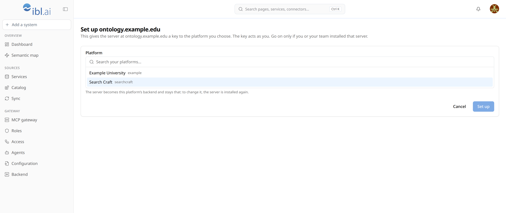
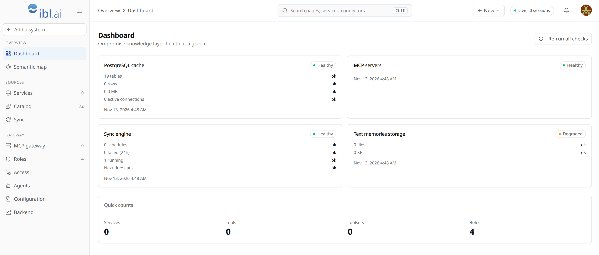
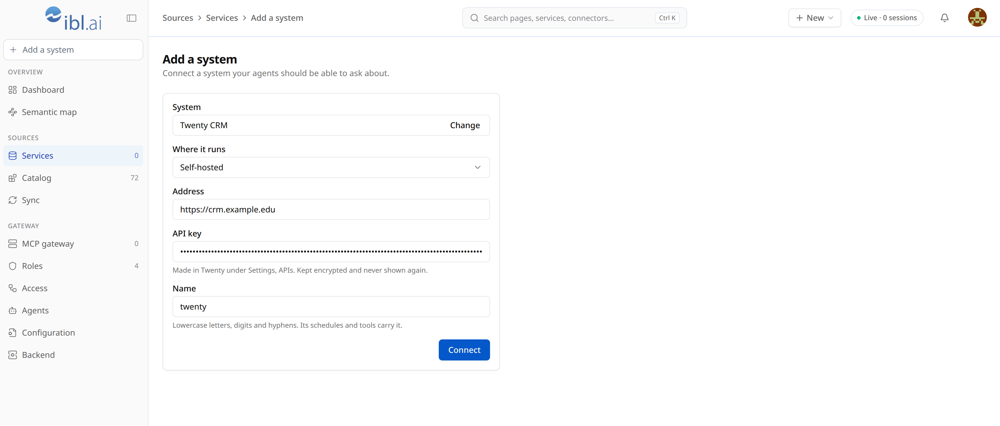
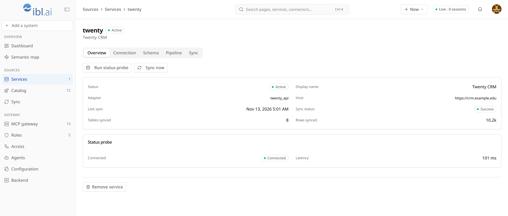
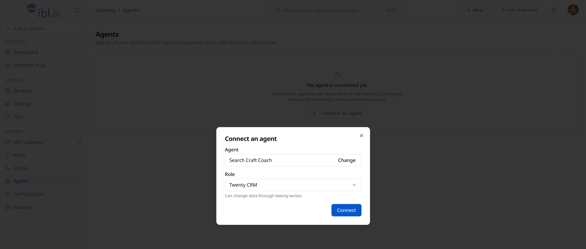
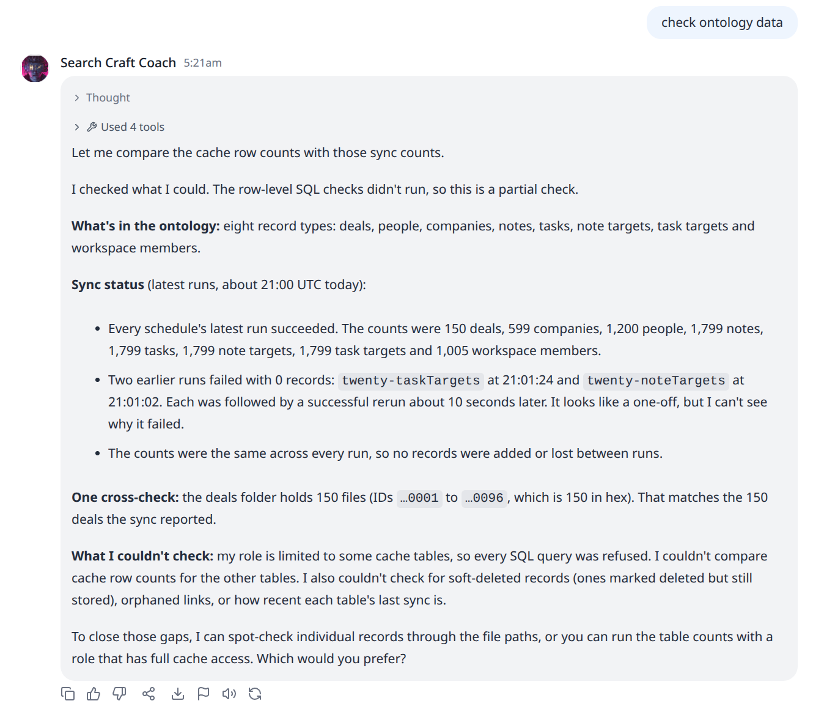
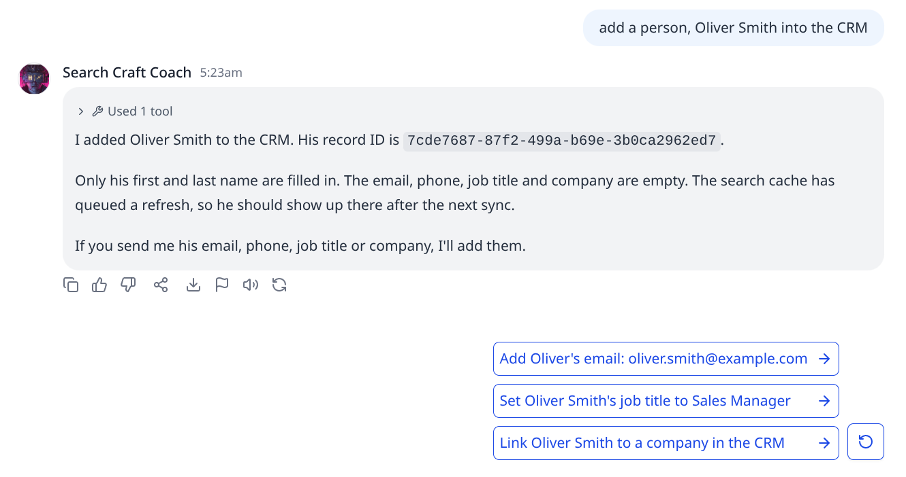

# Install ibl.ai Ontology on your server

For the administrator of an ibl.ai platform who sets up the Ontology Backend on a server of their
own. It shows the one command, what it prints, how the server is set up for your platform, what
ends up on the server, and how the whole thing is configured afterwards.

The frontend, **ibl.ai Ontology**, is at `https://ontology.ibl.ai` and will be available soon. Its
**Connect a backend** screen shows the same command with your host name filled in. This page is
the long version.

## What you end up with

| Where | What |
|---|---|
| Your server | The Ontology Backend: the gateway your agents call, the sync worker, a database with the synced copy of your systems, the search index and an HTTPS proxy. All of it runs in Docker. |
| Your ibl.ai platform | The roles that say what an agent may reach, the backend's key, and one key per agent you connect. |
| ibl.ai Ontology | The frontend you manage it from. It runs nothing of yours: it sends what you do to your server. |

## Before you start

- **A server**: Ubuntu 22.04 or later, amd64, with root access. A fresh one is best. The script
  installs Docker if it is missing; besides that it adds one folder, `/opt/iblai-ontology`, and
  Docker's own volumes and images. No firewall rule is changed.
- **A host name** that points to the server, such as `ontology.example.edu`. Create the DNS record
  first: the certificate cannot be issued until the name resolves to the server.
- **Ports 80 and 443 open to the internet.** 80 is used for the certificate and to send http on to
  https; everything else goes over 443. ibl.ai Ontology and your platform call from addresses that
  change, so they cannot be let in by address; every call is checked by sign-in or key instead.
- **Outbound https** from the server to your ibl.ai platform, to the systems you will connect, and
  to GitHub and `ghcr.io` for the install itself.
- **An administrator's sign-in** on your ibl.ai platform, for step 2. The server itself is given
  no key and no password.

## Step 1. On the server: run the command

```bash
curl -fsSL https://github.com/iblai/ontology/releases/latest/download/install.sh \
  | sudo bash -s -- \
    --host <your server's host name>
```

To read the script before running it, download it first:
`curl -fsSL https://github.com/iblai/ontology/releases/latest/download/install.sh | less`.

It asks for nothing: no key, no platform. What it prints, with Docker's own output left out (this
is the script's text, on a fresh server and a platform that keeps no ontology records yet; a
server that has Docker starts with "Docker with Compose is already here: nothing to install."):

```text
Installing Docker and Compose from Ubuntu's own archive (docker.io, docker-compose-v2).
This server reaches the platform.
This platform keeps no ontology records yet: the connected systems and the schedules will
live on this server. The roles still live in the platform.
Writing /opt/iblai-ontology/.env (readable by root alone).
Getting compose.yaml of version <version> and the images.
Starting the backend.
Waiting for https://ontology.example.edu/mcp: the certificate comes first (up to 3 minutes).

The ontology backend is running (version <version>).

  Open this to finish (works once):
  https://ontology.ibl.ai/#host=ontology.example.edu&code=<32 characters>

  It asks you to sign in to ibl.ai and to choose the platform this server is for.
  Lost it? Run the install command again.

  The address agents call:   https://ontology.example.edu/mcp

  Its two files:   /opt/iblai-ontology/compose.yaml
                   /opt/iblai-ontology/.env
  Keep a copy of .env somewhere safe: its key decrypts the logins of the connected systems.
  The connected systems and the schedules live on this server; only the roles are in the ibl.ai platform.

  Logs:      docker compose -f /opt/iblai-ontology/compose.yaml logs --follow
  Upgrade:   run the install command again
  Remove:    run it with --uninstall
```

What it does, in order:

1. **Checks the server**: root, Ubuntu 22.04 or later, amd64. Otherwise it stops and says why.
2. **Docker**: uses the one that is there. With none, it installs `docker.io` and
   `docker-compose-v2` from Ubuntu's own archive; no repository or key file is added.
3. **Asks for the host name** if the command did not carry it. Nothing else is asked.
4. **Asks the ibl.ai platform two things, with no key, before it writes anything.** Whether this
   server reaches it: a network the platform does not let through stops the install here. And
   whether the platform keeps ontology records: the answer decides where your settings live (see
   [Where things are kept](#where-things-are-kept)).
5. **Writes `/opt/iblai-ontology/.env`**, readable by root alone, with four secrets and the
   link's code, all generated.
6. **Downloads `compose.yaml`** of the same release beside it and pulls the images.
7. **Starts the backend** and waits up to three minutes for `https://<host name>/mcp` to answer.
8. **Prints the link.**

Until the link is used the server belongs to no platform, and it answers nothing but the link.
Keep the link to yourself until then: it works once, for whoever opens it and administers an
ibl.ai platform.

To see every step without changing anything, add `--dry-run`: it asks nothing and prints what it
would do.

## Step 2. In the browser: open the link and choose the platform

1. Open the link the install printed, and sign in to ibl.ai if you are asked.
2. The frontend names your server and asks which platform it is for. If you administer one
   platform, you see its name. If you administer several, pick it from the list: nothing is
   chosen for you, and picking a platform you are not signed in to signs you in to it first.
3. Press **Set up**.



Your server then checks the link's code, asks your platform that you administer the platform you
chose and that its administrators can grant ontology roles, and makes its own key in your
platform, in your name. The key is never shown and never leaves your server. With it the backend
keeps your platform's roles and connects your agents. The frontend then opens its pages.



The server now belongs to that platform. To give it to another one, remove it and install it
again.

On another computer, ibl.ai Ontology asks for the host name once: under **Connect a backend**,
enter it and press **Connect**. If your backend answers at another address (a port, a path), give
it under **Advanced**.

## Step 3. Connect a system

**Add a system** → pick it → give what it asks → **Connect**.



- **Twenty CRM**: "Twenty cloud" or "Self-hosted" with its address, and an API key from Twenty's
  Settings → APIs. The key is tried on the spot. Its records start arriving at once, and a role
  named after the system now exists that may read those records and change them. A second
  Twenty CRM connects the same way: give it a name of its own, and its records are kept in
  tables and folders of their own, apart from the first's.
- **A database** (PostgreSQL, MySQL, Oracle, SQL Server, Snowflake and others): its host, port, a
  read-only login and the database. You then see its structure, run the read-only test and approve
  it before anything is synced.
- **Custom API**: any other system that has a web API. See below.
- **NVIDIA Auto Ontology**: a server of it that you already run. Its business terms then show
  on the Semantic map. See below.



**Name** is what people will call the system, for example "Admissions CRM". The technical name
its schedules, tools and role carry is worked out from it and shown under the field.

### A system with a web API

Pick **Custom API** for a system that is not in the list. Nothing is copied from it: an agent
calls it when it needs to, and only the calls you name.

1. Give its **address** (where its endpoints start, for example `https://api.example.edu/v1`),
   how it is signed in to (a bearer token, a key in a header of its own, or nothing) and a name,
   then **Connect**. The key is kept encrypted on your server and is never shown again.
2. On the system's page, under **Endpoints**, press **Add an endpoint** for each call an agent
   may make: a name, what it does (the agent reads this to decide when to call it), the method
   and the path. Put a part of the path that changes in braces, as in
   `/invoices/{invoice_id}`; list the names an agent may add after the `?` under **Query**.
3. Press **Try** on an endpoint that only reads to see what the system answers.

An endpoint with the method GET only reads. Any other method changes data: an agent may call it
only when its role holds the system's `-writes` toolset by name, and each such call is recorded
before it is made. A role named after the system holds both of its toolsets; give them to other
roles on **Access**.

The address is `https://`. `http://` is taken only for a system inside your own network. A system
at this server's own address is refused.

### Business terms from NVIDIA Auto Ontology

If you run an [NVIDIA Auto Ontology](https://github.com/NVIDIA/auto-ontology) server, it has
already worked out business terms for your databases, such as *Student* or *Invoice line*: what
each one means, which tables and columns hold it, and how tables join where the database does
not say. Connecting it puts those terms on the **Semantic map**, on the tables you connected
here. This server only reads from it: nothing is sent there and nothing in it is changed.

1. In Auto Ontology, as a user with the **viewer** role, open the user menu → **API Tokens** →
   **New token** and copy the token. A viewer's token is enough.
2. **Add a system** → **NVIDIA Auto Ontology**. Give its **address** (the one you open it at,
   for example `https://auto-ontology.example.edu`), the **token** and a name, then **Connect**.
   Its terms are read at once. The token is kept encrypted on your server and is never shown
   again.
3. Open the **Semantic map**. **Terms** is now a kind in the legend. A term is linked to each
   table that holds it, and a dashed line between two tables is a join Auto Ontology inferred.
   Select a term to read what it means, its other names, whether it is certified, the business
   name of each of its columns and its named calculations. Pick a role under **Focus role** to
   see which terms its agents can reach.
4. The terms are read again when you press **Read again** on the system's page, under **Terms**.
   Do it after Auto Ontology has rebuilt its layer, or someone there has certified a term.

A term shows on the map when one of its tables is in a system connected here. The two are
matched by name: the database, the schema and the table are called the same on both sides,
letter case aside. The **Terms** tab lists each database Auto Ontology knows, with the system
here that holds it. When two systems here hold a database of the same name, nothing says which
one is meant, and its terms are not drawn.

Only a database Auto Ontology can read gets terms: PostgreSQL, MySQL, Snowflake, Trino and
ClickHouse. Oracle, SQL Server, Twenty and a custom API get none. One reading takes at most
1,000 terms and 45 seconds, and says so when it stopped short.

The address follows a custom API's rules: `https://`, or `http://` for a server inside your own
network, and never this server's own address.

### Business terms written here

Without an Auto Ontology server, a database system can still get a business term for each of its
tables. On the system's page, under **Terms**, press **Generate terms**. Your ibl.ai platform's
model is asked, one table at a time, and is sent the names and types of the table and its columns
and which columns are keys. It is never sent a row, and nothing is sent before you press the
button. Each question uses your platform's credits.

One press works for about 45 seconds, the biggest tables first, and says how many tables are
left; press again to go on. The terms show on the **Semantic map** like those of Auto Ontology,
marked as generated here and not certified. Discovering the system again keeps a table's term
while its columns stay the same.

## Step 4. Connect an agent

**Agents** → **Connect an agent** → pick one of your platform's agents and a role → **Connect**.



The frontend makes a key that carries that role and nothing more, registers your server on that
agent, and switches the agent's MCP tool on. **Remove** on the same page deletes the key, so the
agent's access ends at once.

What a role may do is set on **Access**. Pick a role: each system, source, tool and toolset then
has a **Read** switch and a **Write** switch, and a system with a web API also has one switch per
method (GET, POST and so on). A switch resting in the middle means the role holds some of what is
under it. The role's name says how far it reaches, as in "Academic Advisor (Read-Write)".

## Step 5. Ask the agent

Open the agent's chat on your platform. It can list the tables it may query, query them, and,
with a role that allows it, create and update records through named operations (for Twenty CRM:
people, companies, opportunities, notes and tasks; nothing is deleted). Each change is recorded
before it runs.





## How it is configured

### The two files

Everything the install leaves outside Docker is one folder:

| File | What it is |
|---|---|
| `/opt/iblai-ontology/compose.yaml` | What runs, as shipped by the release. An upgrade replaces it; do not edit it. |
| `/opt/iblai-ontology/.env` | This server's own settings and secrets. An upgrade never changes it. |

### The settings in `.env`

| Setting | Comes from | What it does |
|---|---|---|
| `ONTOLOGY_HOST` | `--host` | The server's host name: the certificate is issued for it, and agents call `https://<it>/mcp`. |
| `IBLAI_BASE_URL` | Set by the install | The ibl.ai platform's address, `https://api.iblai.app/dm`: where every sign-in and key is checked, and where the roles are kept. |
| `ONTOLOGY_DATA_STORE` | The platform's answer at install | `rbac`: the connected systems and schedules are kept on this server. `dm`: the platform keeps them. The roles are in the platform either way. |
| `ONTOLOGY_SETUP_CODE` | Generated | The code of the link that sets the server up. Once the server is set up it opens nothing. |
| `ONTOLOGY_DB_PASSWORD` | Generated | The password of the server's own database. |
| `CHROMA_TOKEN` | Generated | The token of the search index. |
| `ONTOLOGY_SECRET_KEY` | Generated | The backend's signing secret. |
| `ONTOLOGY_CREDENTIAL_KEY` | Generated | Encrypts the logins and API keys of the systems you connect, and the backend's own key. Without it they must be entered again: **keep a copy of `.env` somewhere safe.** |

The platform the server was set up for and the backend's key are not in `.env`: the server keeps
them in its own database, the key encrypted.

To change the host name, edit the file and apply it:

```bash
sudo docker compose -f /opt/iblai-ontology/compose.yaml up --detach
```

After a change of host name, remove and connect your agents again: each was given the old address.

If the backend's key stops working (it was deleted in your platform, or the administrator who set
the server up no longer administers the platform), sign in as an administrator of the platform
and press **Connect** on the frontend's **Backend** page: the server makes itself a new one.

### What runs

| Service | What | Reaches |
|---|---|---|
| `proxy` | Caddy: gets and renews the certificate, sends http on to https | The only one that listens on the server (80, 443) |
| `ontology-gateway` | The gateway agents call, and the frontend's API | Your platform, the connected systems |
| `sync-engine` | The worker that copies your systems on their schedules | Your platform, the connected systems |
| `mcp-toolbox` | Google MCP Toolbox: makes the calls to the custom APIs you connected | Those APIs. Only the gateway reaches it |
| `migrate` | Database migrations; runs once at every start, then exits | The server's database |
| `ontology-db` | PostgreSQL: the synced copy, the sync history, the audit log | Nothing outside |
| `redis` | The worker's queue, kept in memory only | Nothing outside |
| `vector-store` | The search index | Nothing outside |

The database, the queue and the search index sit on a network with no way out to the internet.

### Where things are kept

| What | Where |
|---|---|
| The roles, and who or what holds each | Your ibl.ai platform, as its own RBAC roles |
| The backend's key, and each connected agent's key and MCP server | Your ibl.ai platform |
| Which platform the server belongs to, and its copy of the backend's key, encrypted | This server, always |
| The connected systems with their encrypted logins, the sync schedules, the list of connected agents | This server (`rbac`), or your platform (`dm`) |
| A custom API's key | With its system, encrypted. The gateway adds it to each call: it is in no file, and the MCP Toolbox keeps none |
| A custom API's endpoints | This server, always (`tools.yaml`, in the `config` volume) |
| An Auto Ontology server's token | With its system, encrypted. It is sent only to that server, on the calls that read its terms |
| The terms read from an Auto Ontology server | With its system: this server (`rbac`), or your platform (`dm`) |
| The synced copy of your systems, the memory files, the search index, the audit log | This server, always |
| Which server is your platform's backend | ibl.ai Ontology, for each computer you connect from, until your platform keeps ontology records; then your platform |

What to back up: `/opt/iblai-ontology/.env`, and two Docker volumes. `iblai-ontology_db` holds
the audit log, the platform the server belongs to with the backend's key, and with `rbac` the
connected systems and the list of connected agents. `iblai-ontology_config` holds the tools and
schedules a connection adds. The synced copy, the memory files and the search index are rebuilt
by syncing again; the certificate is issued again by itself.

## Day to day

```bash
sudo docker compose -f /opt/iblai-ontology/compose.yaml ps                                  # what is running
sudo docker compose -f /opt/iblai-ontology/compose.yaml logs --follow ontology-gateway      # the gateway's log
sudo docker compose -f /opt/iblai-ontology/compose.yaml logs --tail 50 sync-engine          # the last syncs
```

- **Upgrade**: run the install command again. `.env` is kept and nothing is asked; the new
  release's `compose.yaml` and images replace the old ones, and the migrations run. On a server
  that is not set up yet, it prints the link again.
- **Remove**: the same command with `--uninstall`. It asks you to type the host name, then removes
  the containers, the volumes, the images and the folder. Docker stays. With `rbac`, remove each
  agent's connection in the frontend first, so its key is deleted. The roles and the backend's own
  key stay in your platform until you delete them there.

## When the script stops

Until it writes `.env`, a stop leaves nothing behind but Docker, if the script had to install it.
After that, `.env` is kept and a second run asks nothing. Fix the cause and run the same command
again.

| It says | What it means | What to do |
|---|---|---|
| `run it as root, with sudo.` | The command lacked `sudo`. | Run it as shown. |
| `this installs on Ubuntu 22.04 or later…` or `…built for amd64…` | Another system or processor. | Use an Ubuntu 22.04 or later server on amd64. |
| `Docker is installed without Compose…` | Docker is there, its Compose plugin is not. | Add the package the message names, then run it again. |
| `there is no terminal to ask on…` | The command carried no host name, and it was run where it cannot prompt. | Give `--host`, or run it in your own terminal session on the server. |
| `--platform is no longer taken…` | The command is one from an earlier release. | Leave `--platform` out: the platform is chosen when the link is opened. |
| `no answer from the platform at …` | The server cannot reach the ibl.ai platform. | Allow outbound https from the server. |
| `the platform's edge refused this server…` | The network your server is on is not let through to the platform. | Send ibl.ai the server's public address to allow. |
| `the backend did not start…` | A container failed; its last lines are printed above the message. | Read them, fix the cause, run it again. `.env` is kept. |
| `https://…/mcp did not answer in 3 minutes…` | The certificate could not be issued or the server cannot be reached. | Check that the host name points to the server and that ports 80 and 443 are open, then run it again. |

## When Set up is refused

The frontend shows your server's own words under the button. Until Set up succeeds the server
keeps nothing and belongs to no platform.

| It says | What it means | What to do |
|---|---|---|
| `…that is not its code…` | The link is not this server's, or was not copied whole. | Run the install command again and open the link it prints. |
| `Only an administrator of … sets up its backend.` | Your sign-in does not administer that platform. | Pick a platform you administer, or sign in as someone who does. |
| `Your sign-in is for another platform than …` | You are still signed in to another platform. | Pick the platform again on the card. |
| `The administrators of … cannot grant ontology roles yet…` | Your platform is not set up for ontology roles. | Ask ibl.ai to enable them for your platform, then open the link again. |
| `This server belongs to another platform than …` | The server is already set up, for another platform. | Sign in to that platform; or remove the server and install it again. |
| `This server was set up a moment ago by someone else…` | Two people used the link at the same moment. | Delete the unused key the message names, in your platform. |
| `The ibl.ai platform did not answer…` | Your server could not reach the platform. | Try again; check outbound https from the server. |

## The script's options

| Option | |
|---|---|
| `--host <host name>` | The name the server answers at. |
| `--dry-run` | Say what would happen; change nothing and ask nothing. |
| `--uninstall` | Remove the backend, its data and `/opt/iblai-ontology`. |
| `--help` | Print this list. |

A host name not given is asked for. Nothing else is.

More for your technical team: [deployment.md](deployment.md) (the same install in reference form,
and the full stack behind a firewall), [platform-integration.md](platform-integration.md) (how an
agent reaches the gateway) and [identity.md](identity.md) (roles and credentials).
